# Coding Tools｜GIFで詳しく見る使い方

[1操作ずつ見るブラウザ版](visual-guide.html)

全34本のGIFです。各操作に、使うキー・手順・結果をまとめています。画面のコードは操作例です。

## いつでも開くには

- このリポジトリのREADMEにある「GIFで使い方を見る」から開けます。
- VS Codeではこのファイルを開き、Markdownプレビューで読めます（Windows: Ctrl + Shift + V / Mac: Cmd + Shift + V）。
- 更新版のCoding Toolsでは、エクスプローラーの「Coding Tools 設定」→「GIFで使い方を確認」から開けます。設定欄上部の本のアイコンからも開けます。
## 操作前の準備

1. Coding Toolsを有効にします。
2. HTMLとCSSが入ったフォルダーをVS Codeで開きます。
3. 移動・コピー・貼り付けの操作では、対象のエディタをクリックしてからキーを押します。
4. GIF内のcardなどは例です。自分のファイルでは、自分のクラス名に読み替えてください。

キーは初期割り当てです。自分で変更した場合は、変更後のキーを使ってください。

通常のCtrl + C / Ctrl + Vは標準のままです。GIFで使う専用コマンドと区別してください。

## クラス選択

### 01 次のクラス名を選ぶ（Win: Ctrl + 2 / Mac: Cmd + 2）

キーを押すたびに、次のクラス名へ選択が移ります。

1. card を選択している状態。
2. Ctrl + 2 を押す。
3. もう一度押すと、次の行へ。
4. さらに押すと card__text へ。

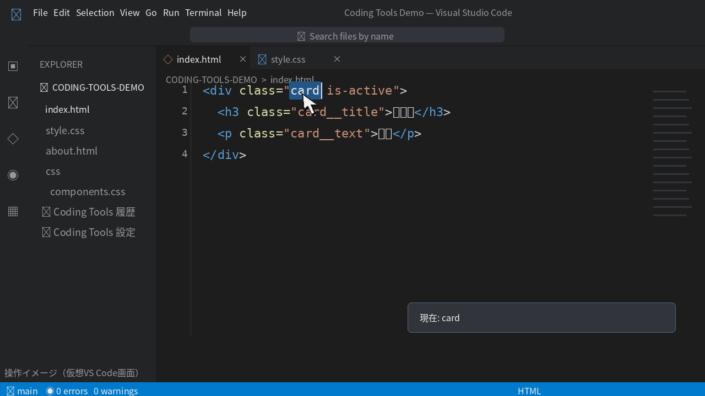

**補足：** クラス名上または全体選択時に使います。補完・スニペット入力中は標準操作を優先します。前はCtrl + 1、次はCtrl + 2です（MacはCmd）。

### 02 前のクラス名を選ぶ（Win: Ctrl + 1 / Mac: Cmd + 1）

後ろから前へ、クラス名を1つずつ選べます。

1. card__text を選択している状態。
2. Ctrl + 1 で1つ前へ。
3. もう一度押すと is-active へ。
4. もう一度押すと card へ。

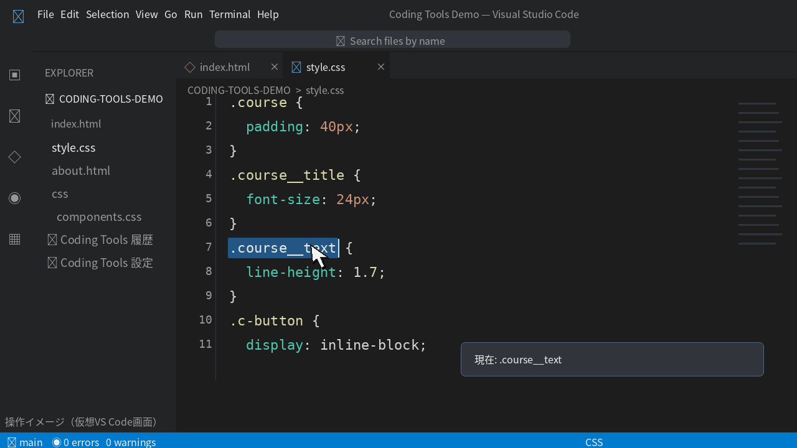

**補足：** クラス名上または全体選択時に使います。補完・スニペット入力中は標準操作を優先します。前はCtrl + 1、次はCtrl + 2です（MacはCmd）。

### 03 同じファイル内の次の同名クラスへ（Ctrl + Tab）

HTML/CSSの同名クラスだけを同じファイル内で次へたどります。端では循環します。

1. item全体を選ぶか、クラス名にカーソルを置く。
2. Ctrl + Tab を押す。
3. もう一度押すと循環する。

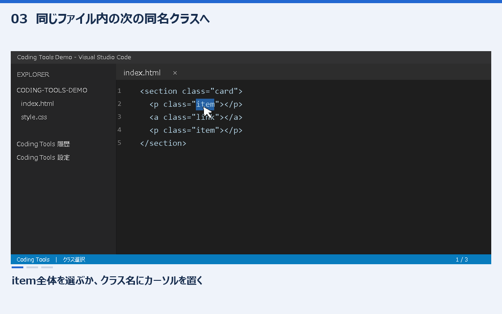

**補足：** HTML⇄CSSやファイル間の移動はCtrl+Alt+3/4を使います。

### 04 同じファイル内の前の同名クラスへ（Ctrl + Shift + Tab）

HTML/CSSの同名クラスだけを同じファイル内で前へたどります。端では循環します。

1. item全体を選ぶか、クラス名にカーソルを置く。
2. Ctrl + Shift + Tab を押す。
3. もう一度押すと循環する。

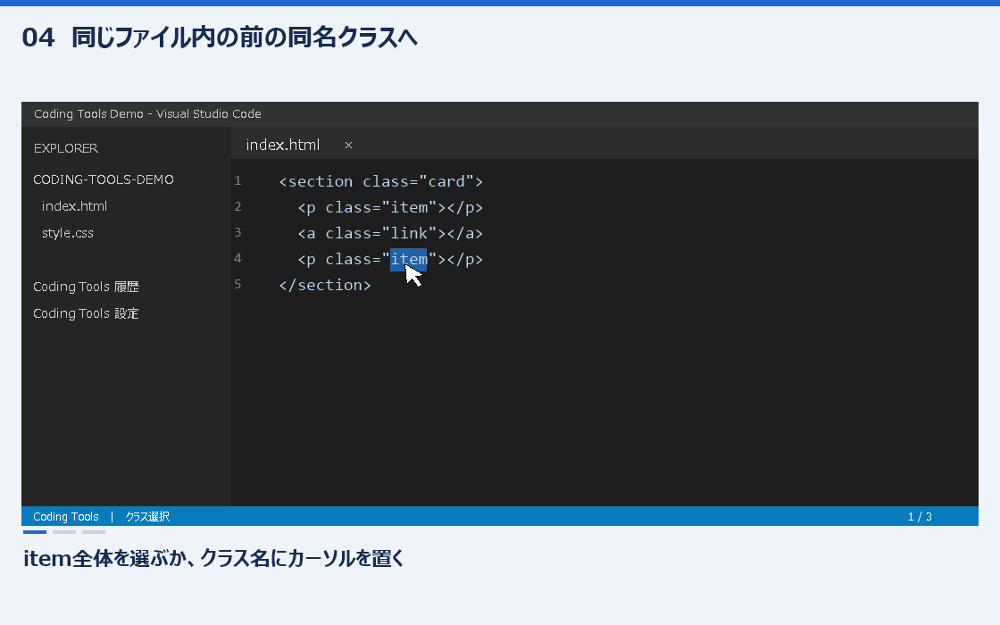

**補足：** HTML⇄CSSやファイル間の移動はCtrl+Alt+3/4を使います。

## コピー・貼り付け

### 05 保存枠1へコピーする（Win: Ctrl + Alt + Shift + 1 / Mac: Cmd + Alt + Shift + 1）

選択した文字やカーソル上のクラス名・ID名を枠1に保存します。クラスは`.名前`、IDは`#名前`で保存し、種別も内部で保持します。CSS以外へ貼るときは記号を外します。

1. 保存したい文字を選択。
2. Ctrl + Alt + Shift + 1 を押す。
3. 枠1にはドット付きで保存される。
4. 枠の表示をOFFにしても、同じコピーキーで保存できる。

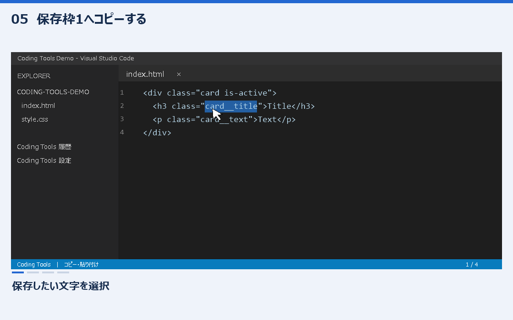

**補足：** コピー枠の表示は設定から変更できます。表示をOFFにしても、コピー・貼り付けのキー操作は使えます。

### 06 保存枠1から貼り付ける（Win: Ctrl + Alt + 1 / Mac: Cmd + Alt + 1）

枠1の内容を貼り付けます。CSSでは位置に合わせてクラスに `.`、IDに `#` を付けます。検索欄では同じキーで検索語全体を名前だけに置き換えます。通常のCtrl+C／Ctrl+Vの内容は変えません。 Windowsでは他アプリにも同じキーで名前だけを貼れます。通常クリップボードは一時使用後に復元します。Macの外部貼り付けは未対応です。

1. 先に保存枠1へコピーしておく。
2. HTMLでは名前だけ：card__title。
3. CSSのセレクタ入力ではドット1つ：.card__title。
4. CSSコメントの中ではドットを付けない。
5. CSS文字列の中ではドットを付けない。
6. CSSの宣言値でもドットを付けない。
7. ほかの言語でも名前だけを貼る。

**補足：** CSSのセレクタ入力ではドットを1つ付けます。HTML・コメント・文字列・宣言値・他言語では名前だけを貼ります。CSS空行への自動追加は「CSSへの追加」のGIFで確認できます。

### 07 保存枠2へコピーする（Win: Ctrl + Alt + Shift + 2 / Mac: Cmd + Alt + Shift + 2）

選択した文字やカーソル上のクラス名・ID名を枠2に保存します。クラスは`.名前`、IDは`#名前`で保存し、種別も内部で保持します。CSS以外へ貼るときは記号を外します。

1. 保存したい文字を選択。
2. Ctrl + Alt + Shift + 2 を押す。
3. 枠2にはドット付きで保存される。
4. 枠の表示をOFFにしても、同じコピーキーで保存できる。

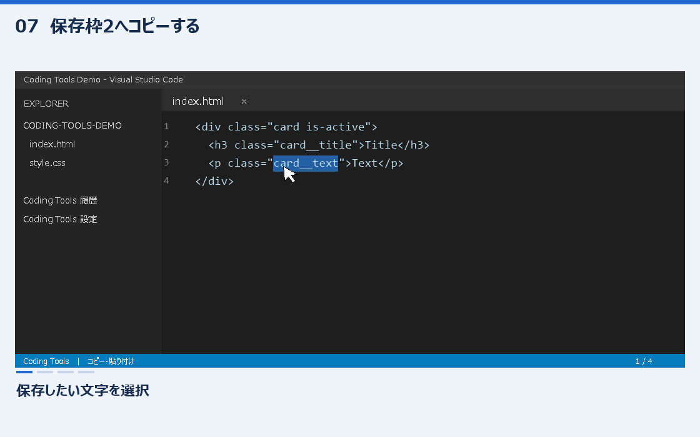

**補足：** コピー枠の表示は設定から変更できます。表示をOFFにしても、コピー・貼り付けのキー操作は使えます。

### 08 保存枠2から貼り付ける（Win: Ctrl + Alt + 2 / Mac: Cmd + Alt + 2）

枠2の内容を貼り付けます。CSSでは位置に合わせてクラスに `.`、IDに `#` を付けます。検索欄では同じキーで検索語全体を名前だけに置き換えます。通常のCtrl+C／Ctrl+Vの内容は変えません。 Windowsでは他アプリにも同じキーで名前だけを貼れます。通常クリップボードは一時使用後に復元します。Macの外部貼り付けは未対応です。

1. 先に保存枠2へコピーしておく。
2. HTMLでは名前だけ：card__text。
3. CSSのセレクタ入力ではドット1つ：.card__text。
4. CSSコメントの中ではドットを付けない。
5. CSS文字列の中ではドットを付けない。
6. CSSの宣言値でもドットを付けない。
7. ほかの言語でも名前だけを貼る。

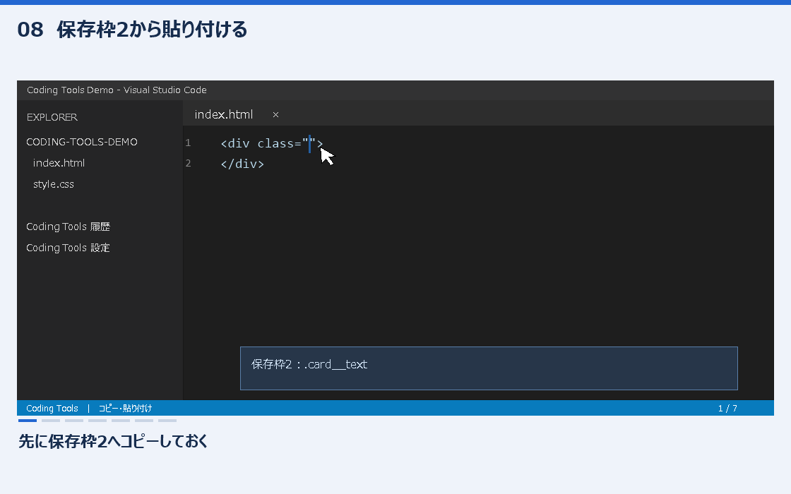

**補足：** CSSのセレクタ入力ではドットを1つ付けます。HTML・コメント・文字列・宣言値・他言語では名前だけを貼ります。CSS空行への自動追加は「CSSへの追加」のGIFで確認できます。

## HTMLとCSSの移動

### 09 HTMLからCSS定義へ移動（Win: Ctrl + Alt + 3 / Mac: Cmd + Alt + 3）

HTMLのクラス名を選んで、対応するCSSの場所へ直接移動します。

1. HTMLの card__title を選択。
2. Ctrl + Alt + 3 を押す。
3. CSSの定義が選択される。

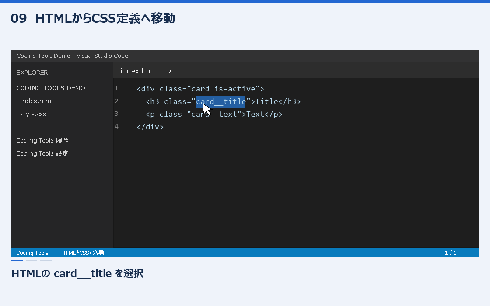

### 10 CSSからHTMLの使用箇所へ移動（Win: Ctrl + Alt + 4 / Mac: Cmd + Alt + 4）

CSSのクラス名から、そのクラスを使っているHTMLへ移動します。

1. CSSの .card__title を選択。
2. Ctrl + Alt + 4 を押す。
3. HTMLの使用箇所が選択される。

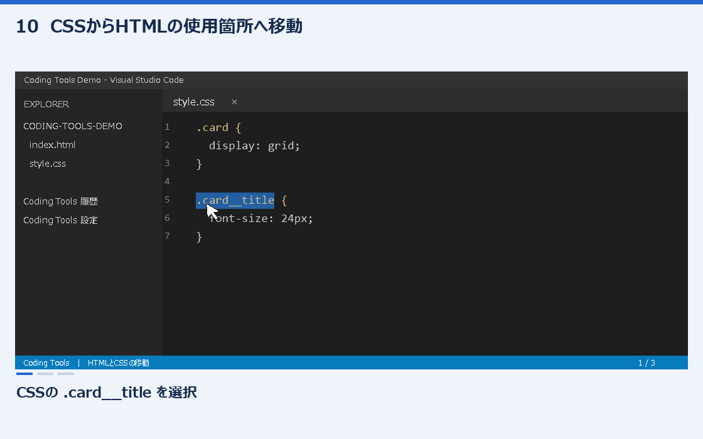

### 11 次のジャンプ候補へ移動（下部のジャンプ候補表示をクリック）

ジャンプ先が複数ファイルにあるとき、下部の候補表示をクリックして次へ移れます。

1. HTML→CSSのジャンプ直後。
2. 下部のジャンプ候補表示をクリック。
3. もう一度クリックすると最初の候補へ。

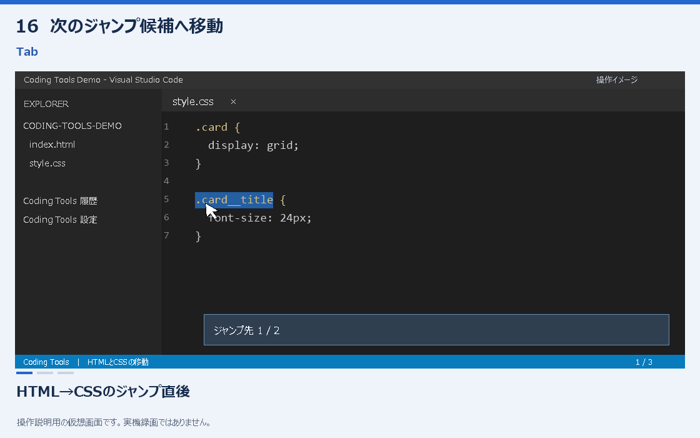

**補足：** Ctrl+1/2はファイル内の前／次のクラス移動に使います。候補を離れるかEscを押すと切り替えを終えます。

### 12 前のジャンプ候補へ移動（任意のキーを割り当て）

前のジャンプ候補コマンドに独自のキーを割り当てると、複数ファイルの候補を逆順に見られます。

1. ジャンプ先 2 / 2 を表示中。
2. 割り当てたキーを押す。
3. 前の候補へ戻った。

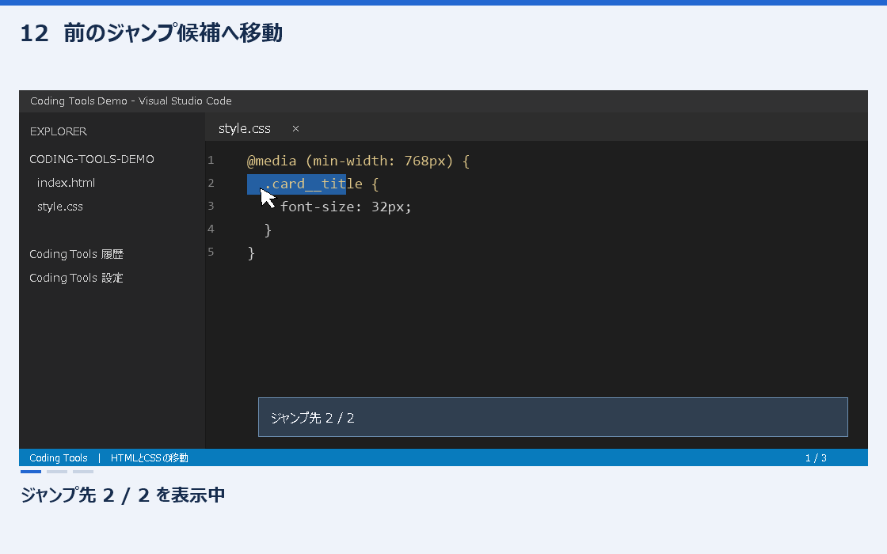

**補足：** 初期キーはありません。Ctrl+Shift+Tabは同じファイル内の前の同名クラスに使います。

### 13 ジャンプ候補の切り替えを終える（Esc）

Escで切り替えを終了し、今の場所から編集を続けられます。

1. ジャンプ候補の切り替え中。
2. Esc を押す。
3. 候補の表示が消え、通常の編集へ。

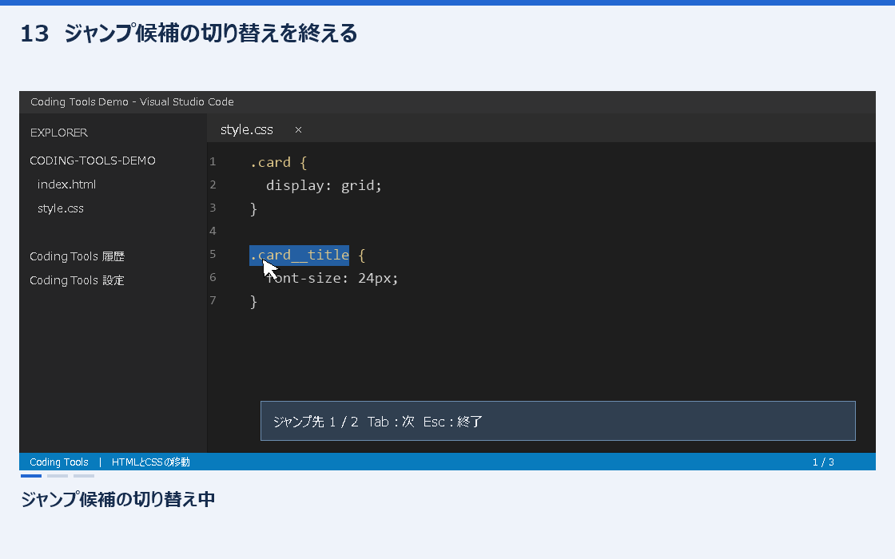

### 14 同じコマンドでHTMLとCSSを行き来する（任意のキーを割り当て）

開いている言語に合わせて、HTMLのクラスからCSSへ、CSSのクラスからHTMLへ移動します。既存の相互ジャンプ処理を使います。

1. HTMLのクラス名を選択するかカーソルを置く。
2. 割り当てたキーでCSSへ移動する。
3. 同じキーを押すとHTMLの使用箇所へ移動する。

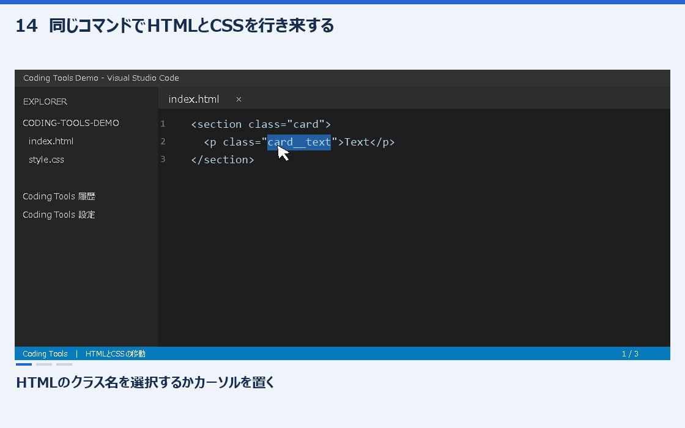

**補足：** キーボードショートカット一覧で「対応するHTML／CSSへ移動」に任意のキーを割り当てます。標準の定義移動とCtrl+Alt+3/4はそのまま使えます。

## CSSへの追加

### 15 CSSに空のルールを追加する（Win: Ctrl + Alt + 1 / 2 / Mac: Cmd + Alt + 1 / 2）

CSSの空行で枠1・2から貼ると、コピー元の構造と今のCSSから位置を決め、目印と空ルールを直接追加します。

1. section内のクラスを先にコピーする。
2. CSSの空行で Ctrl + Alt + 1。
3. 目印の下へ直接追加される。
4. 目印がないCSSでも、同じキーで貼り付ける。
5. 登録した書式で目印を作り、その下へ追加する。
6. コピー元の領域が分からない場合。
7. 仮置きの目印を作り、その下へ追加する。

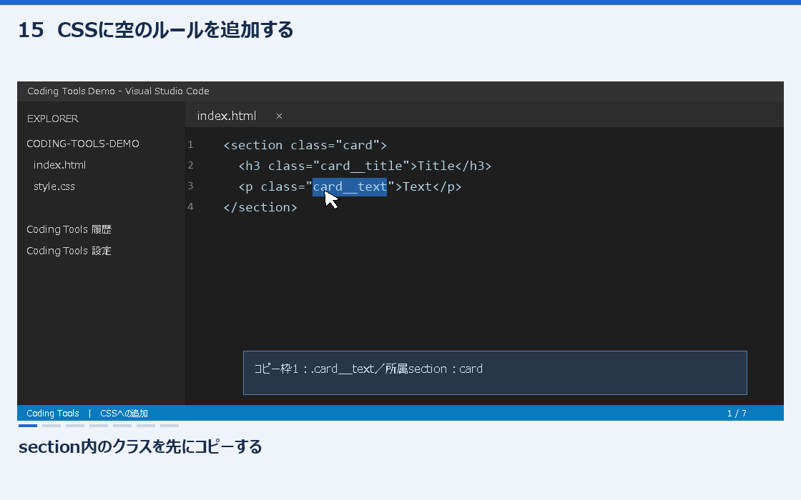

**補足：** 既定は候補画面なし。領域が分からなければ仮置きの目印を作ります。既存コードは動かさず、Undoで戻せます。

### 16 同名のCSSがあれば、その場所へ移動（Win: Ctrl + Alt + 1 / 2 / Mac: Cmd + Alt + 1 / 2）

同じ適用範囲に同じセレクタがあれば、追加せず既存箇所へ自動で移動します。

1. CSSの空行で枠1・2から貼り付け。
2. 選択画面なしで既存の場所へ移動する。

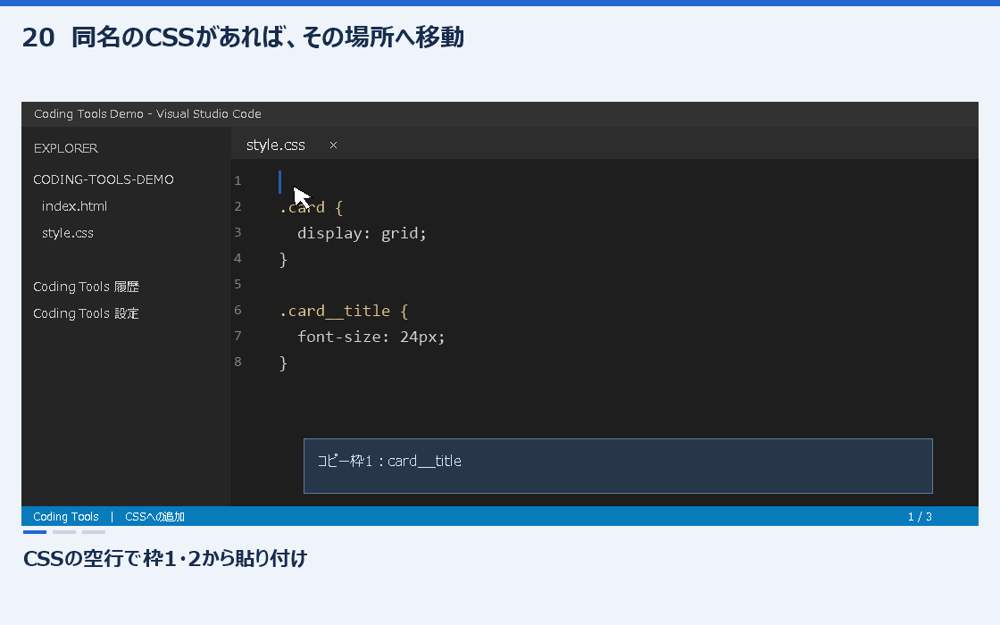

### 17 既存の条件内へ追加する（Win: Ctrl + Alt + 1 / 2 / Mac: Cmd + Alt + 1 / 2）

記述済みの@mediaなどの空行で貼ると、その条件の範囲内へ空ルールを直接追加します。

1. 記述済みの条件内の空行にカーソルを置く。
2. Ctrl + Alt + 1 で条件内に直接追加する。

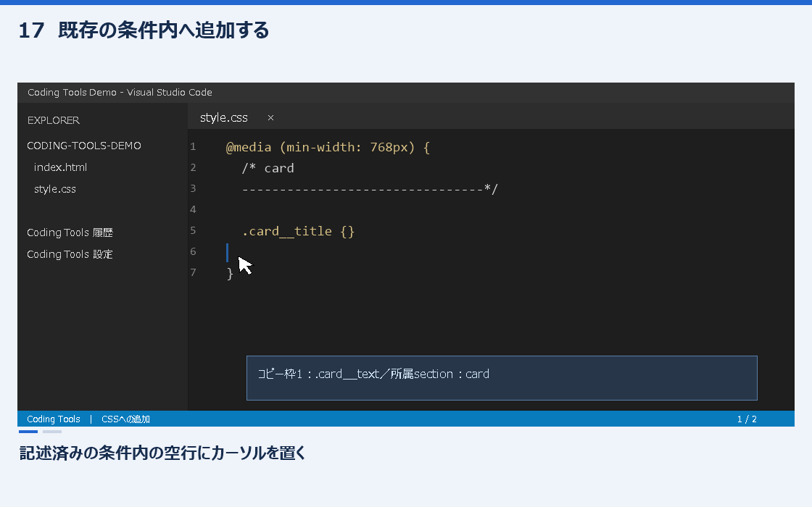

**補足：** クエリーは自分で書きます。拡張は新しいクエリーを作りません。

### 18 CSSを解析できなければ中止する（Win: Ctrl + Alt + 1 / 2 / Mac: Cmd + Alt + 1 / 2）

構文が壊れているなど、安全に追加できない場合は編集を中止します。

1. 閉じかっこが余っているCSSの空行にカーソルを置く。
2. 枠1・2からクラスを貼り付ける。
3. 自動では変更されない。

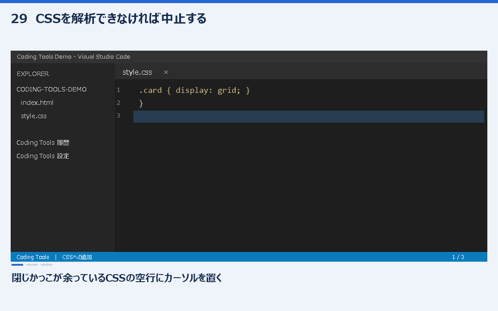

## 履歴

### 19 履歴の行をクリックして差分を見る（履歴の行をクリック / Enter）

月の中にある履歴の行を選ぶと、その変更内容が開きます。

1. 操作履歴と月を展開する。
2. 10:20:00 style.css をクリック。
3. 選んだ履歴の差分が開く。

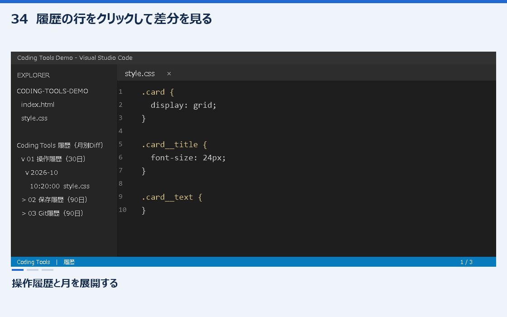

### 20 履歴から変更元ファイルを開く（履歴の行を右クリック → 変更元ファイルへ移動）

履歴の行から、編集した元ファイルの場所へ戻れます。

1. 履歴の行を右クリックする。
2. 「差分の変更元ファイルへ移動」を選ぶ。
3. 元の style.css の変更箇所が開く。

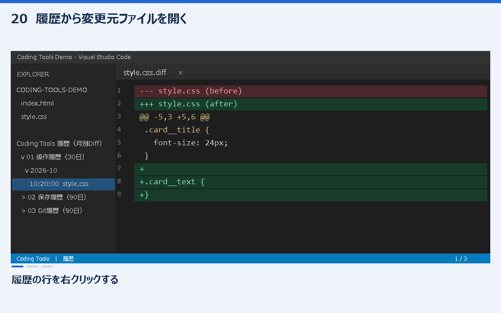

**補足：** Git pushの履歴から実行した場合は、ソース管理画面を開きます。

### 21 履歴の表示を更新する（履歴欄上部の更新アイコン）

保存済みの履歴を読み直して、パネルの表示を更新します。

1. 履歴パネルを表示中。
2. パネル上の履歴欄上部の更新アイコンをクリック。
3. 現在の保存内容で表示される。

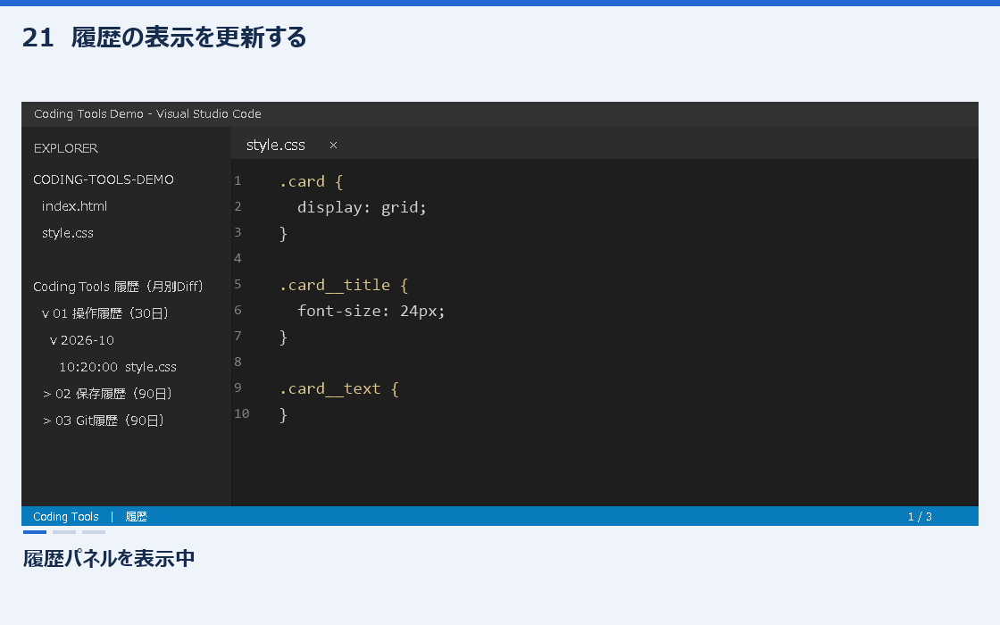

### 22 履歴フォルダーを開く（履歴欄上部のフォルダーアイコン）

保存された履歴のフォルダーを、OSのエクスプローラーで開きます。

1. 履歴欄上部のフォルダーアイコンをクリック。
2. 履歴保存先のフォルダーが開く。
3. 保存されている差分ファイルを確認できる。

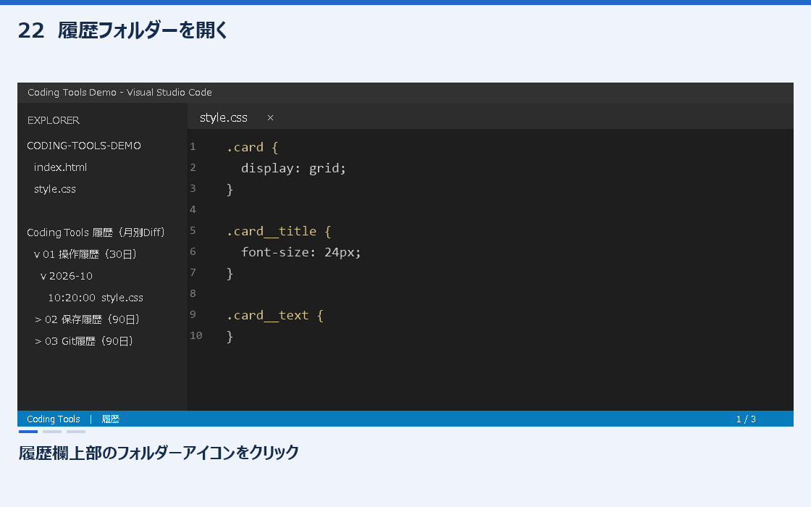

### 23 ファイル保存時の差分を残す（Win: Ctrl + S / Mac: Cmd + S）

保存履歴がONなら、前回保存した内容からの変更を保存時に記録します。

1. 前回保存したCSS。
2. font-size を 24px から 28px に編集。
3. Ctrl + S でファイルを保存。
4. 保存履歴で差分を確認できる。

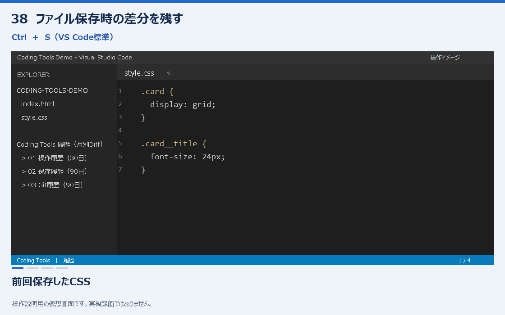

**補足：** 同じ内容を保存しただけの場合は記録しません。

### 24 Coding ToolsからGit pushして記録する（履歴欄上部のGit pushアイコン）

専用コマンドでpushが成功した場合に、Git push履歴を記録します。

1. 実行前にブランチと送信先を準備。
2. 履歴欄上部のGit pushアイコンをクリック。
3. 「実行」を選び、push成功を待つ。
4. Git履歴ONなら記録される。

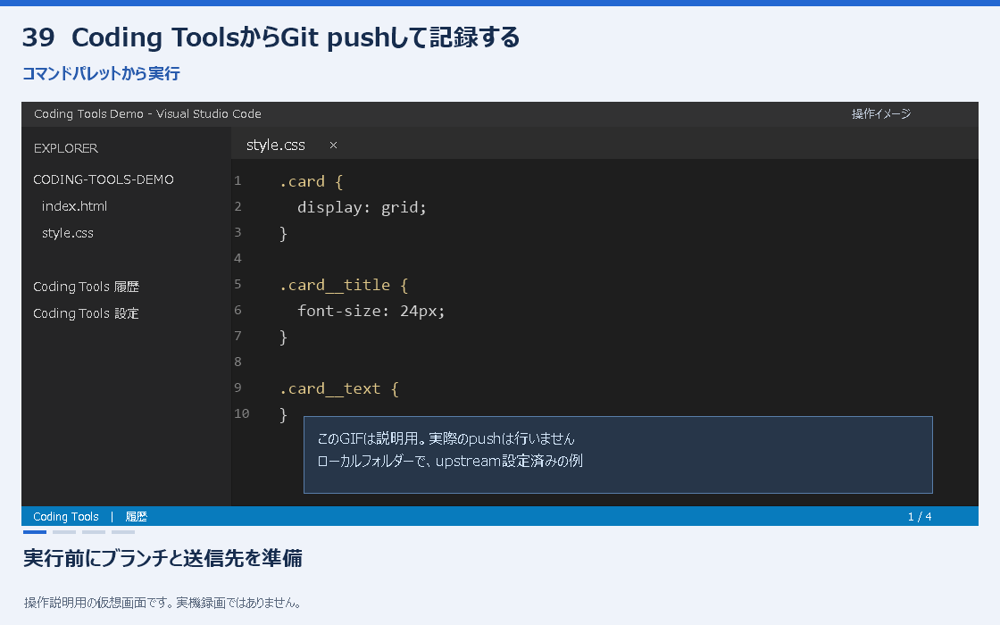

**補足：** 通常のターミナルや、ほかの拡張機能から行ったpushは記録の対象外です。

## 設定

### 25 Coding Toolsの設定を開く（下部のCoding Toolsをクリック）

下部のCoding Toolsから設定を開けます。操作ヘルプの表示はON/OFFに切り替えられます。

1. 下部のCoding Toolsから設定を開く。
2. 「ヘルプの表示・表示時間」を選ぶ。
3. ON：クラス名にカーソルを置くと行末にヘルプが出る。
4. 表示が不要なら「Help: Enabled」のチェックを外す。
5. OFF：カーソルを置いても行末のヘルプは出ない。
6. 再びチェックすると、次の操作からヘルプを表示する。

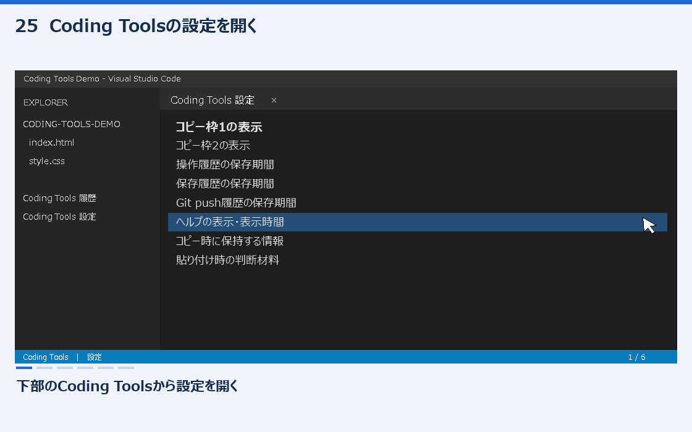

**補足：** 「ヘルプの表示・表示時間」→「Help: Enabled」で切り替えます。OFFでも移動・コピー・貼り付けの操作は使えます。既定の表示時間は2秒です。 コピー枠の番号・ボタン・初期キー・保存内容は「コピー枠1の表示」「コピー枠2の表示」で個別に変更できます。

### 26 操作履歴の記録を停止・再開する（設定欄の対象行をクリック / Enter）

操作履歴の保存期間でOFFを選ぶと停止し、日数を選ぶと記録を再開します。

1. 操作履歴の保存期間を開く。
2. 「OFF（記録しない）」を選んで Enter。
3. 記録が停止し、保存期間の行にOFFと表示される。
4. もう一度開いて 30日を選ぶ。
5. 日数を選ぶと、その期間で記録を再開。

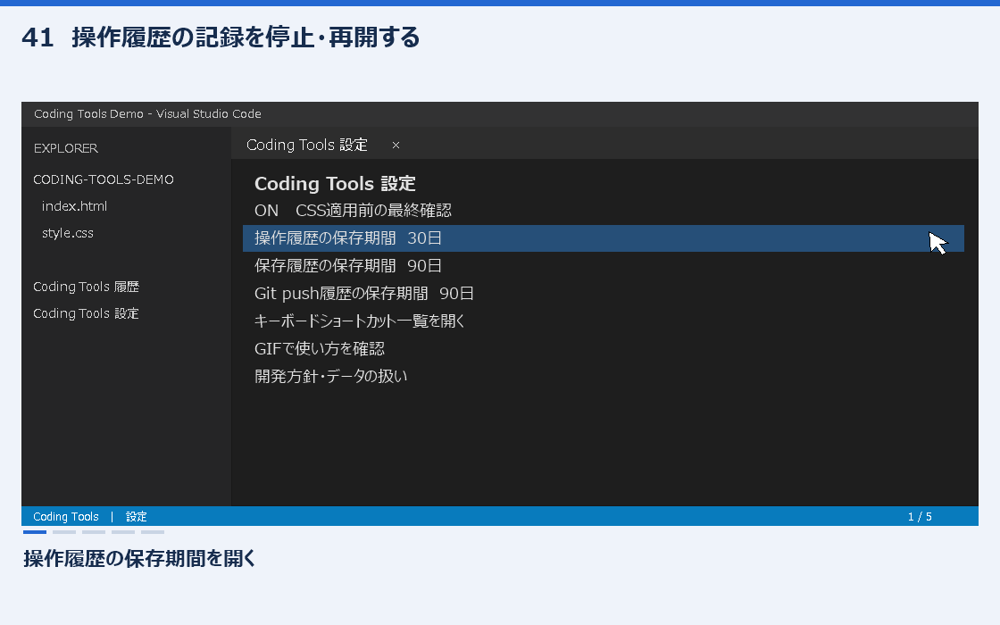

**補足：** OFFは新しい記録を停止します。保存済みの履歴の保持期間は変えません。

### 27 保存履歴の記録を停止・再開する（設定欄の対象行をクリック / Enter）

保存履歴の保存期間でOFFを選ぶと停止し、日数を選ぶと記録を再開します。

1. 保存履歴の保存期間を開く。
2. 「OFF（記録しない）」を選んで Enter。
3. 記録が停止し、保存期間の行にOFFと表示される。
4. もう一度開いて 90日を選ぶ。
5. 日数を選ぶと、その期間で記録を再開。

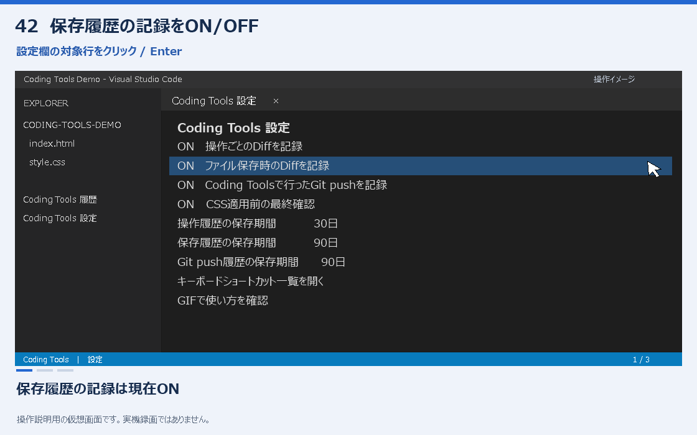

**補足：** OFFは新しい記録を停止します。保存済みの履歴の保持期間は変えません。

### 28 Git push履歴の記録を停止・再開する（設定欄の対象行をクリック / Enter）

Git push履歴の保存期間でOFFを選ぶと停止し、日数を選ぶと記録を再開します。

1. Git push履歴の保存期間を開く。
2. 「OFF（記録しない）」を選んで Enter。
3. 記録が停止し、保存期間の行にOFFと表示される。
4. もう一度開いて 90日を選ぶ。
5. 日数を選ぶと、その期間で記録を再開。

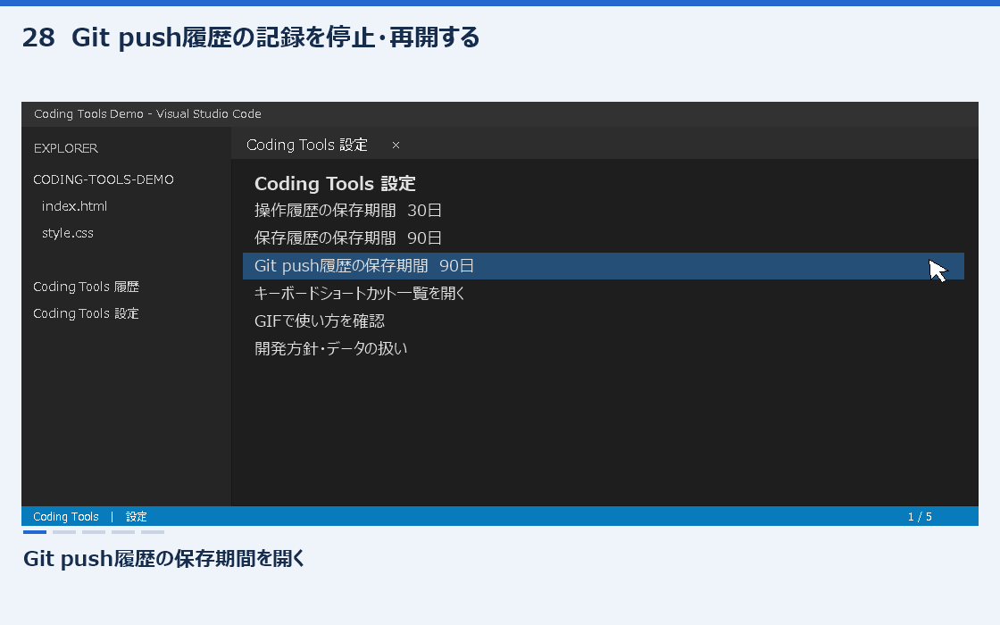

**補足：** OFFは新しい記録を停止します。保存済みの履歴の保持期間は変えません。Git pushの実行自体は停止しません。

### 29 操作履歴の保存期間を変える（設定欄の対象行をクリック / Enter）

操作履歴の記録をOFFにするか、保存期間を1〜360日から選べます。

1. 操作履歴の保存期間の行を選ぶ。
2. 行を開いて日数を選ぶ。
3. 180日を選んで Enter。

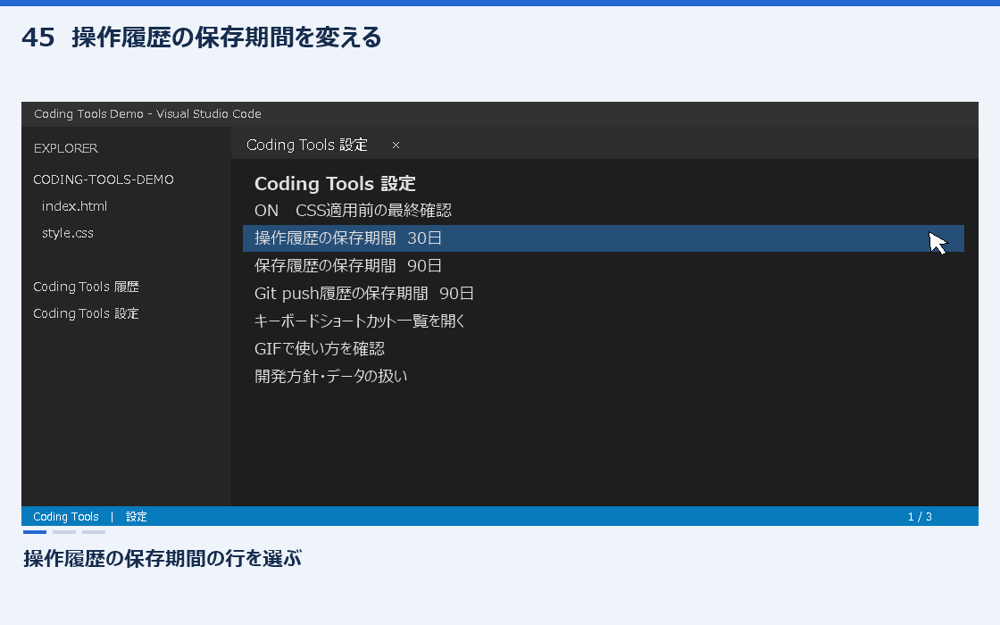

**補足：** 任意の日数を入力する場合も、1〜360の整数を指定します。古い履歴は整理時に削除されます。

### 30 保存履歴の保存期間を変える（設定欄の対象行をクリック / Enter）

保存履歴の記録をOFFにするか、保存期間を1〜360日から選べます。

1. 保存履歴の保存期間の行を選ぶ。
2. 行を開いて日数を選ぶ。
3. 180日を選んで Enter。

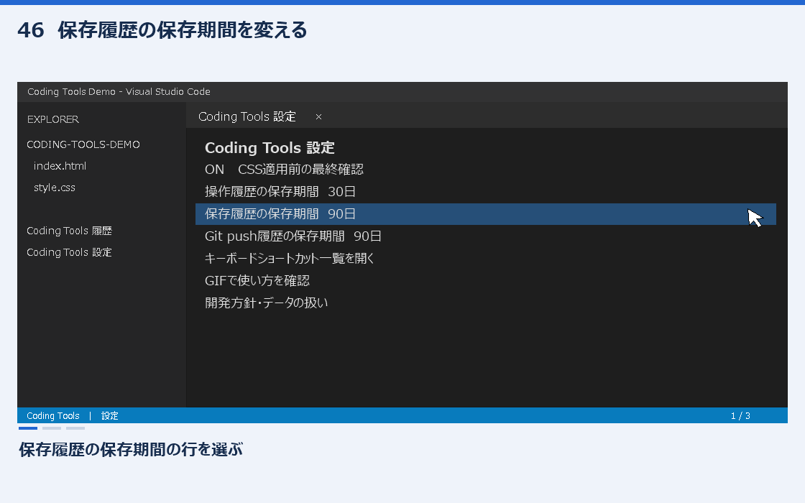

**補足：** 任意の日数を入力する場合も、1〜360の整数を指定します。古い履歴は整理時に削除されます。

### 31 Git push履歴の保存期間を変える（設定欄の対象行をクリック / Enter）

Git push履歴の記録をOFFにするか、保存期間を1〜360日から選べます。

1. Git push履歴の保存期間の行を選ぶ。
2. 行を開いて日数を選ぶ。
3. 180日を選んで Enter。

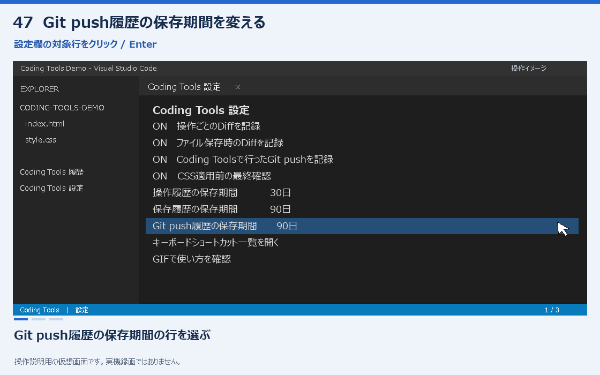

**補足：** 任意の日数を入力する場合も、1〜360の整数を指定します。古い履歴は整理時に削除されます。

### 32 ショートカット一覧を開いて変える（Coding Tools → キーボードショートカット一覧）

VS Code標準のショートカット一覧で、Coding Toolsのキーを変更できます。

1. 設定欄のショートカット一覧を開く。
2. 検索欄に Coding Tools を入力。
3. 変えたい行のキー変更を開く。
4. 重複を確認してから使用する。

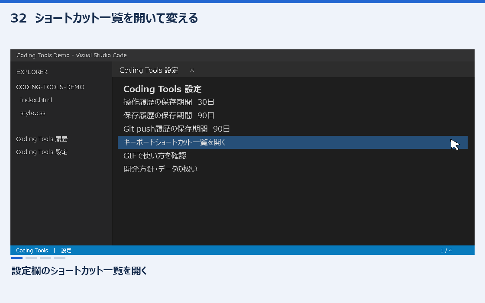

### 33 このGIFガイドを開く（Coding Tools → GIFで使い方を確認）

Coding Toolsの設定欄から、1操作ずつのGIFガイドを開けます。

1. 設定欄の使い方ガイドを選ぶ。
2. VS Code内にガイドが開く。
3. 見たい操作の見出しを開く。

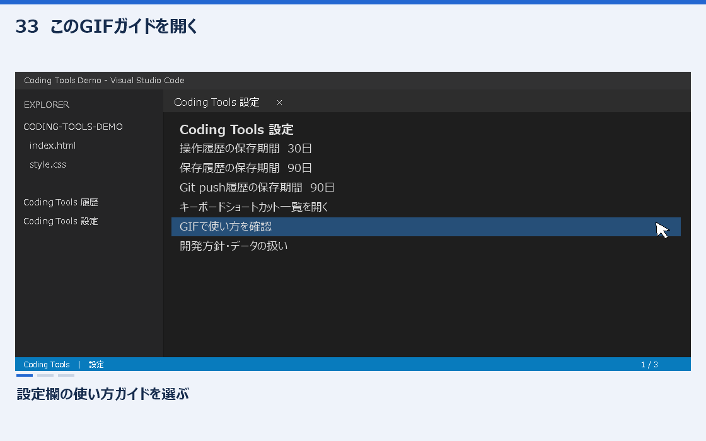

## CSSの設定

### 34 クラスの接頭辞ごとに追加先を指定する（VS Code 設定：codingTools.placementRules）

接頭辞に応じたCSS配置設定で、基本ルールか記述済み@mediaの候補を初期選択できます。

1. VS Codeのワークスペース設定を開く。
2. CSSの空行で枠1から貼り付け、条件の候補をEnterで選ぶ。
3. Enterで確定すると、条件内に空ルールが増える。

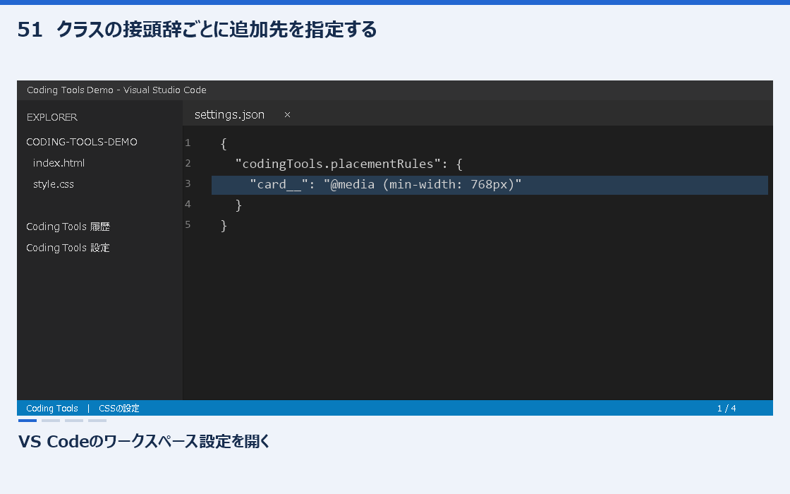

**補足：** 候補は自分で変更できます。別ファイルへ移動したり、新しい@mediaを作成したりはしません。

## 困ったとき

- GIFが動かない：ブラウザ版を開き、「GIFを単独で開く」を選んでください。ブラウザやOSの「動きを減らす」が有効な場合、ガイド内では静止画になります。
- キーが反応しない：HTML/CSSのエディタにカーソルを戻し、キーボードショートカット一覧で割り当てと競合を確認してください。
- ジャンプできない：HTMLとCSSを含むフォルダーをVS Codeで開き、クラス名全体を選ぶか、そのクラス名にカーソルを置いてください。
- 貼り付け枠が空：先に同じ番号のコピー操作を実行してください。
- CSS追加が止まる：CSS構文と対応形式を確認してください。SCSS/LESSの自動配置は対象外です。
- 履歴が出ない：記録の設定をONにし、対象の編集・保存・Coding Tools経由のpushを行ってください。コピーだけでは差分履歴は増えません。
