# Coding Tools｜GIFで詳しく見る使い方

[1操作ずつ見るブラウザ版](visual-guide.html)

全51本のGIFです。各操作に、使うキー・手順・結果をまとめています。画面のコードは操作例です。

## いつでも開くには

- このリポジトリのREADMEにある「GIFで使い方を見る」から開けます。
- VS Codeではこのファイルを開き、Markdownプレビューで読めます（Windows: Ctrl + Shift + V / Mac: Cmd + Shift + V）。
- 更新版のCoding Toolsでは、エクスプローラーの「Coding Tools 設定」→「GIFで使い方を確認」から開けます。設定欄上部の本のアイコンからも開けます。
- コマンドパレットから「Coding Tools: GIFで使い方ガイドを開く（1操作ずつ）」でも開けます。

コマンドパレットはWindowsでは Ctrl + Shift + P、Macでは Cmd + Shift + P で開きます。表示された検索欄にコマンド名を入力してください。

## 操作前の準備

1. Coding Toolsを有効にします。
2. HTMLとCSSが入ったフォルダーをVS Codeで開きます。
3. 移動・コピー・貼り付けの操作では、対象のエディタをクリックしてからキーを押します。
4. GIF内のcardなどは例です。自分のファイルでは、自分のクラス名に読み替えてください。

操作説明用の仮想画面です。実機録画や動作検証の記録ではありません。キーは初期割り当てです。自分で変更した場合は、変更後のキーを使ってください。

通常のCtrl + C / Ctrl + Vは標準のままです。GIFで使う専用コマンドと区別してください。

## クラス選択

### 01 次のクラス名を選ぶ

キーを押すたびに、次のクラス名へ選択が移ります。

**Windows：** Ctrl + Alt + J

**Mac：** Cmd + Alt + J

1. card を選択している状態。
2. Ctrl + Alt + J を押す。
3. もう一度押すと、次の行へ。
4. さらに押すと card__text へ。

### 02 前のクラス名を選ぶ

後ろから前へ、クラス名を1つずつ選べます。

**Windows：** Ctrl + Alt + K

**Mac：** Cmd + Alt + K

1. card__text を選択している状態。
2. Ctrl + Alt + K で1つ前へ。
3. もう一度押すと is-active へ。
4. もう一度押すと card へ。

### 03 次のクラスも追加選択する

元の選択を残し、次のクラス名を追加します。

**Windows：** Ctrl + Alt + Shift + J

**Mac：** Cmd + Alt + Shift + J

1. card を選択。
2. Ctrl + Alt + Shift + J。
3. もう一度押して3つを同時選択。

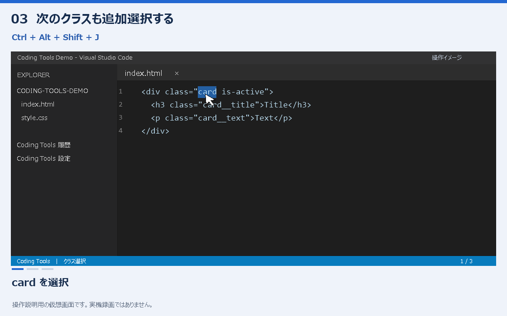

### 04 前のクラスも追加選択する

元の選択を残し、前のクラス名を追加します。

**Windows：** Ctrl + Alt + Shift + K

**Mac：** Cmd + Alt + Shift + K

1. card__text を選択。
2. Ctrl + Alt + Shift + K。
3. もう一度押して is-active も追加。

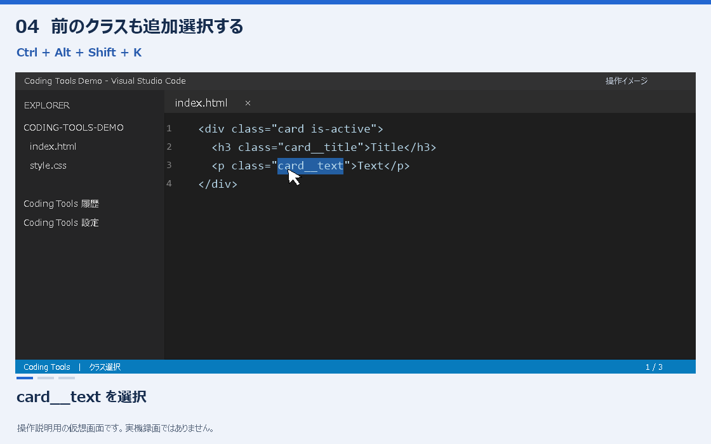

## コピー・貼り付け

### 05 保存枠1へコピーする

選んだ文字を保存枠1に覚えさせます。コピーだけではコードは変わりません。

**Windows：** Ctrl + Alt + Shift + 1

**Mac：** Cmd + Alt + Shift + 1

1. 保存したい文字を選択。
2. Ctrl + Alt + Shift + 1 を押す。
3. 保存枠1に残る。もう片方の枠はそのまま。

### 06 保存枠1から貼り付ける

保存枠1に覚えた内容を、今のカーソル位置へ貼り付けます。

**Windows：** Ctrl + Alt + 1

**Mac：** Cmd + Alt + 1

1. 先に保存枠1へコピーしておく。
2. 貼り付けたい位置で Ctrl + Alt + 1。
3. 同じ枠は何度でも貼り付けられる。

### 07 保存枠2へコピーする

選んだ文字を保存枠2に覚えさせます。コピーだけではコードは変わりません。

**Windows：** Ctrl + Alt + Shift + 2

**Mac：** Cmd + Alt + Shift + 2

1. 保存したい文字を選択。
2. Ctrl + Alt + Shift + 2 を押す。
3. 保存枠2に残る。もう片方の枠はそのまま。

### 08 保存枠2から貼り付ける

保存枠2に覚えた内容を、今のカーソル位置へ貼り付けます。

**Windows：** Ctrl + Alt + 2

**Mac：** Cmd + Alt + 2

1. 先に保存枠2へコピーしておく。
2. 貼り付けたい位置で Ctrl + Alt + 2。
3. 同じ枠は何度でも貼り付けられる。

### 09 一覧でコピー先の枠を選ぶ

番号を覚えていなくても、一覧から保存枠を選べます。

**開き方：** コマンドパレットで「Coding Tools: コピー先を一覧から選択」を実行します。

1. コピーする文字を選択。
2. 「コピー先を一覧から選択」を実行。
3. 枠1を選んで Enter。

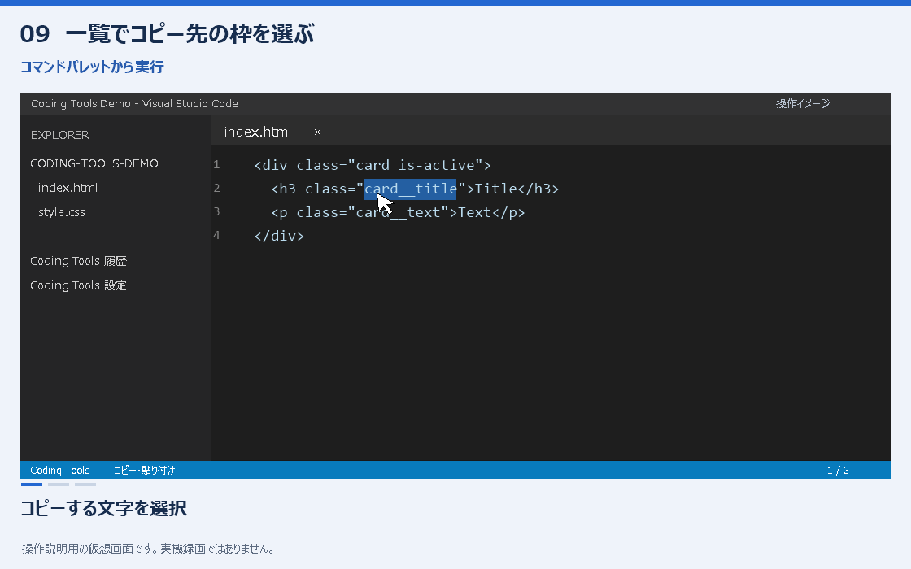

### 10 一覧で貼り付け元の枠を選ぶ

保存してある文字を見ながら、使う枠を選べます。

**開き方：** コマンドパレットで「Coding Tools: 貼り付け元を一覧から選択」を実行します。

1. 貼り付けたい位置にカーソルを置く。
2. 「貼り付け元を一覧から選択」を実行。
3. 枠2を選んで Enter。

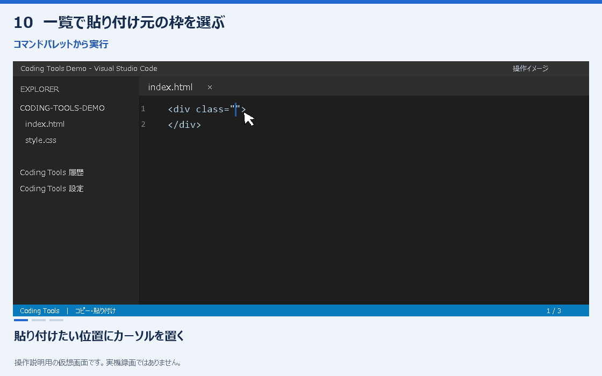

### 11 カーソル上のクラス名をコピー

クラス名の上にカーソルを置くだけで、その名前をコピーできます。

**Windows：** Ctrl + Alt + Shift + C

**Mac：** Cmd + Alt + Shift + C

1. CSSのクラス名にカーソルを置く。
2. Ctrl + Alt + Shift + C。
3. コピーされる文字はドットなし。

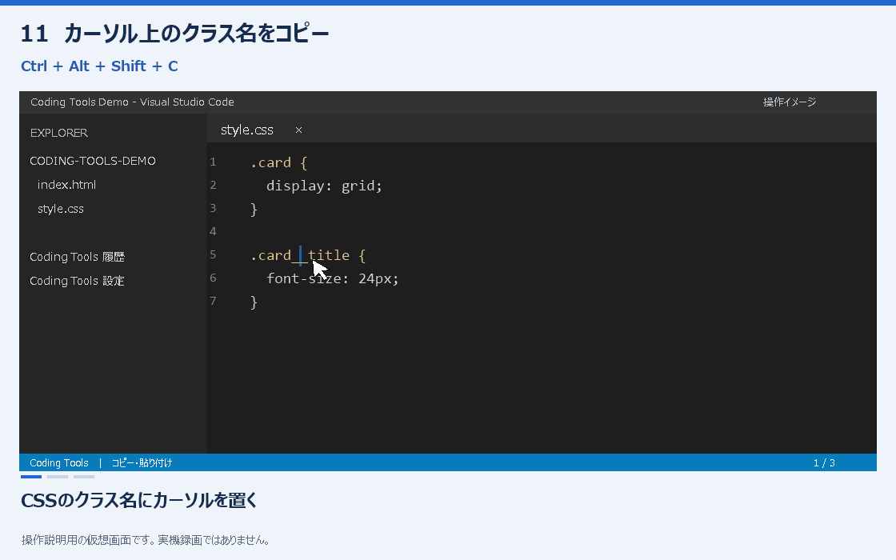

### 12 スマートコピーでドットを外す

クラス名全体を選んで実行すると、ドットなしの名前をコピーします。

**開き方：** コマンドパレットで「Coding Tools: スマートコピー（クラスならドットなし）」を実行します。

1. CSSで .card__title 全体を選択。
2. 「スマートコピー」を実行。
3. 検索欄などにも使える文字になる。

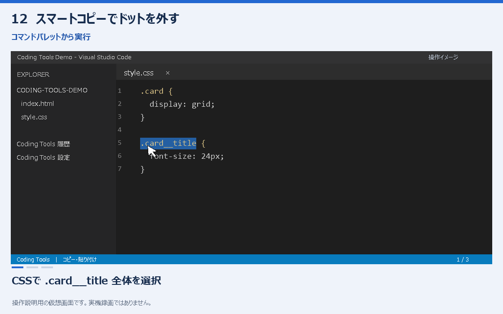

### 13 スマート貼り付けでドットを付ける

拡張機能でコピーしたクラスを、CSSの入力中の位置へ貼り付けます。

**開き方：** コマンドパレットで「Coding Tools: CSSスマート貼り付け（クラスならドット付き）」を実行します。

1. 拡張機能で card__title をコピー済み。
2. 「CSSスマート貼り付け」を実行。
3. CSSではドット付きで入力される。

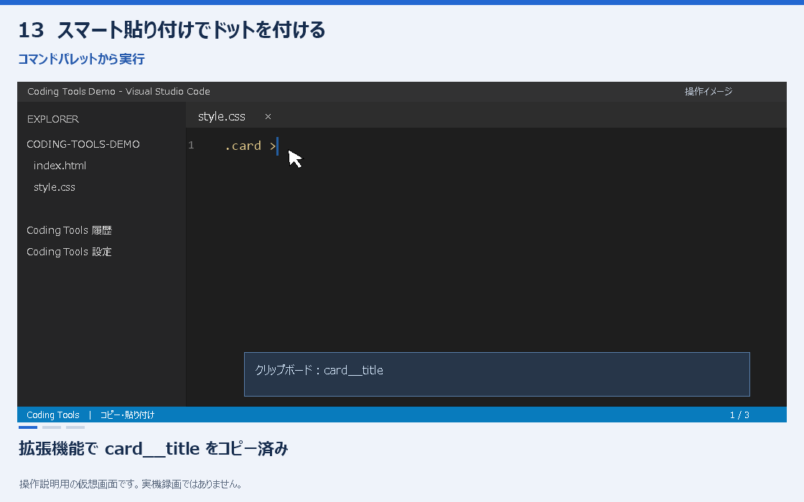

**補足：** 空いている場所で実行した場合は、CSSの追加先を判断する処理へ進みます。

## HTMLとCSSの移動

### 14 HTMLからCSS定義へ移動

HTMLのクラス名を選んで、対応するCSSの場所へ直接移動します。

**Windows：** Ctrl + Alt + 3

**Mac：** Cmd + Alt + 3

1. HTMLの card__title を選択。
2. Ctrl + Alt + 3 を押す。
3. CSSの定義が選択される。

### 15 CSSからHTMLの使用箇所へ移動

CSSのクラス名から、そのクラスを使っているHTMLへ移動します。

**Windows：** Ctrl + Alt + 4

**Mac：** Cmd + Alt + 4

1. CSSの .card__title を選択。
2. Ctrl + Alt + 4 を押す。
3. HTMLの使用箇所が選択される。

### 16 次のジャンプ候補へ移動

ジャンプ先が複数あるとき、Tabで次の候補へ移れます。

**Windows：** Tab

1. HTML→CSSのジャンプ直後。
2. Tab を押す。
3. さらに Tab で最初の候補へ戻る。

**補足：** ジャンプ候補の切り替え中だけ、Tabがこの操作になります。

### 17 前のジャンプ候補へ移動

ジャンプ候補をShift + Tabで逆順に見られます。

**Windows：** Shift + Tab

1. ジャンプ先 2 / 2 を表示中。
2. Shift + Tab を押す。
3. 前の候補へ戻った。

### 18 ジャンプ候補の切り替えを終える

Escで切り替えを終了し、今の場所から編集を続けられます。

**Windows：** Esc

1. ジャンプ候補の切り替え中。
2. Esc を押す。
3. 候補の表示が消え、通常の編集へ。

## CSSへの追加

### 19 CSSに空のルールを追加する

コピーしたクラスの追加先を調べ、差分を確認してから空のCSSルールを追加します。

**Windows：** Ctrl + Alt + P

**Mac：** Cmd + Alt + P

1. 先に拡張機能で card__text をコピー。
2. Ctrl + Alt + P でCSS追加を実行。
3. 変更前と変更後を確認する。
4. 「差分を確認して適用」を選ぶ。

**補足：** 最終確認ONの場合の流れです。既存のCSSルールは移動・書き換えしません。

### 20 同名のCSSがあれば、その場所へ移動

既存ルールへ移動する候補を選ぶと、CSSを書き換えずに目的の場所を開きます。

**Windows：** Ctrl + Alt + P

**Mac：** Cmd + Alt + P

1. card__title をコピー済みで Ctrl + Alt + P。
2. 既存へ移動の候補を選ぶ。
3. Enter で既存の場所へ。

### 21 追加先のCSSファイルを選ぶ

CSSファイルが複数あり追加先を決められない場合は、自分でファイルを選びます。

**Windows：** Ctrl + Alt + P

**Mac：** Cmd + Alt + P

1. HTMLからCSS追加を実行。
2. 使うCSSファイルを選ぶ。
3. 選んだCSSで追加先の確認へ進む。

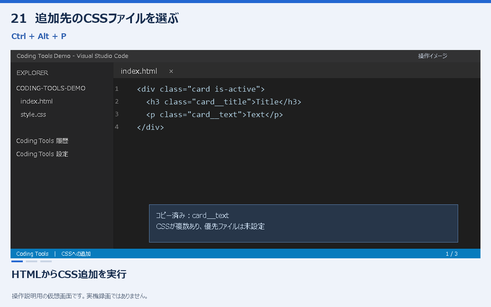

### 22 既存の条件内へ追加する

既存の@mediaなどを選び、その条件の中へ空のルールを追加できます。

**Windows：** Ctrl + Alt + P

**Mac：** Cmd + Alt + P

1. 追加先の候補画面を開く。
2. 条件を選んで Enter。
3. 選んだ条件内に追加される差分を見る。
4. 最終確認で適用する。

### 23 新しい@mediaを作って追加する

条件付きCSSの候補から、新しい@mediaを入力して追加できます。

**Windows：** Ctrl + Alt + P

**Mac：** Cmd + Alt + P

1. 条件付きCSSの追加先を開く。
2. 作る条件を入力して Enter。
3. 新しい条件と空ルールを差分で確認。
4. 適用すると、条件付きルールが増える。

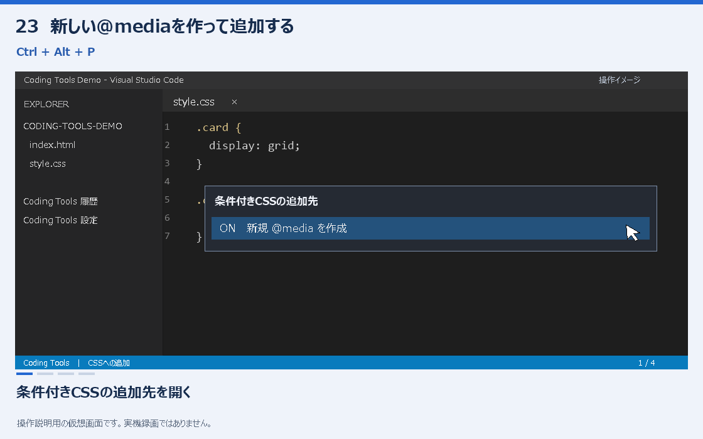

### 24 関係や状態を指定して追加する

追加先の候補から、隣接・状態などを表すセレクタを入力できます。

**Windows：** Ctrl + Alt + P

**Mac：** Cmd + Alt + P

1. .card の追加先候補を表示。
2. 追加するセレクタを入力。
3. 候補選択後、差分を確認する。
4. 適用後は指定した空ルールが増える。

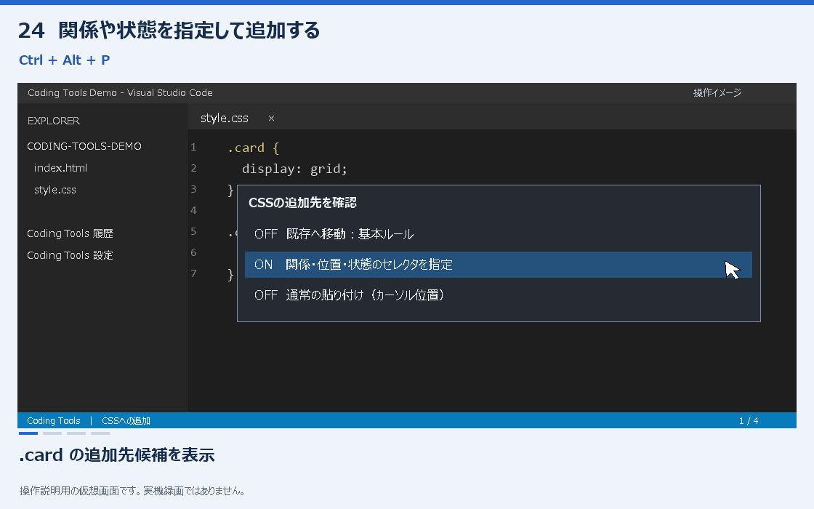

### 25 貼り付け方法から通常貼り付けを選ぶ

貼り付け方法の画面で「通常の貼り付け」を選ぶと、今の位置へ文字を入れます。

**Windows：** Ctrl + Alt + V

**Mac：** Cmd + Alt + V

1. セレクタ文字列 .card をコピー済み。
2. Ctrl + Alt + V を押す。
3. Enter。最終確認ONなら、もう一度確定。
4. 現在のカーソル位置に貼り付けられる。

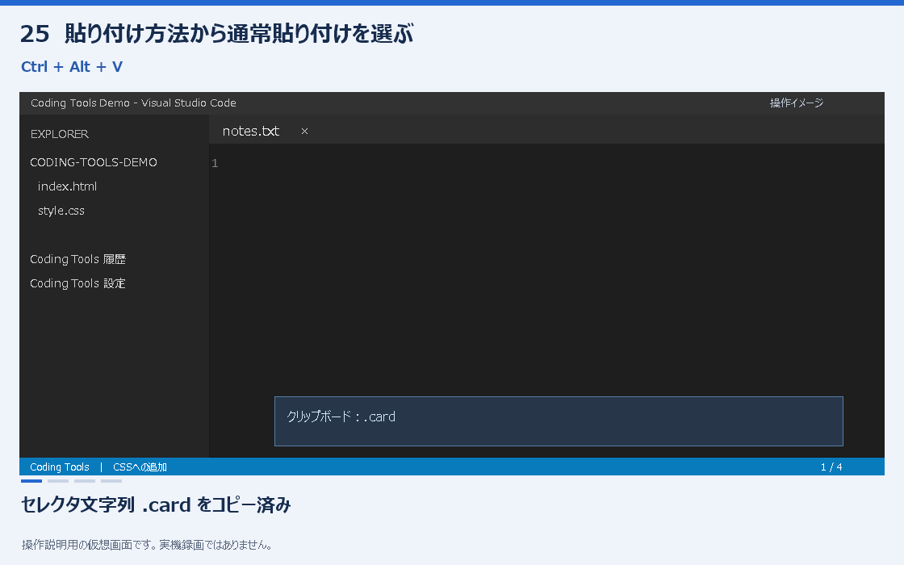

### 26 貼り付け方法からCSS追加を選ぶ

CSSへ整理する方を選ぶと、CSS追加先の判断と差分確認へ進みます。

**Windows：** Ctrl + Alt + V

**Mac：** Cmd + Alt + V

1. card__text を拡張機能でコピー済み。
2. Ctrl + Alt + V でCSS追加を選ぶ。
3. CSSファイルと追加先を選び、差分を確認。
4. 最終確認で適用する。

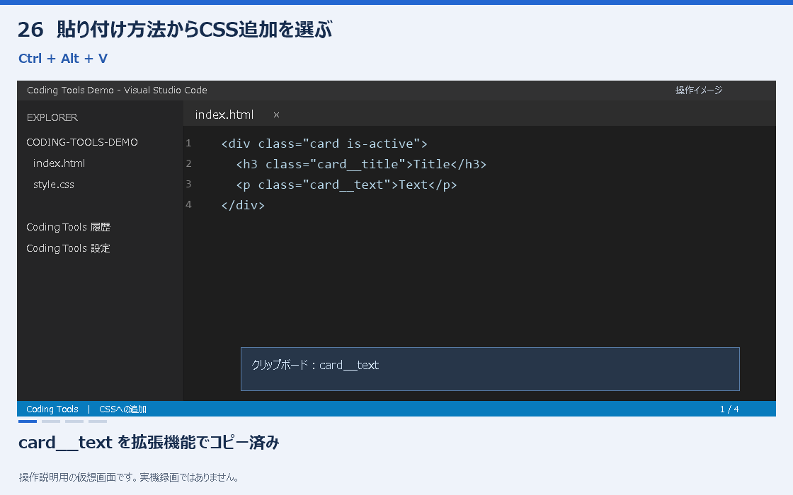

### 27 差分を確認してから適用する

最終確認ONのときは、差分を見て適用ボタンを押すまで元のCSSは変わりません。

**Windows：** Ctrl + Alt + P

**Mac：** Cmd + Alt + P

1. 追加される行を左右で見比べる。
2. 「差分を確認して適用」を選ぶ。
3. 適用後、編集用のCSSが開く。

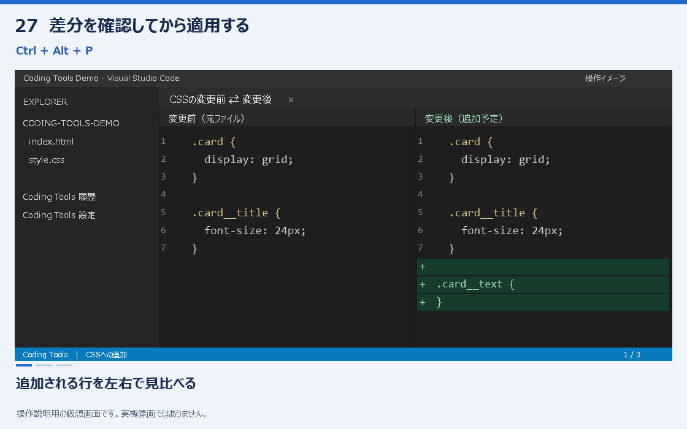

### 28 CSS追加をキャンセルする

差分確認でキャンセルすると、元のCSSを変更せずに終わります。

**Windows：** Ctrl + Alt + P

**Mac：** Cmd + Alt + P

1. 差分プレビューを表示。
2. キャンセルを選ぶ。
3. 元のCSSには追加されていない。

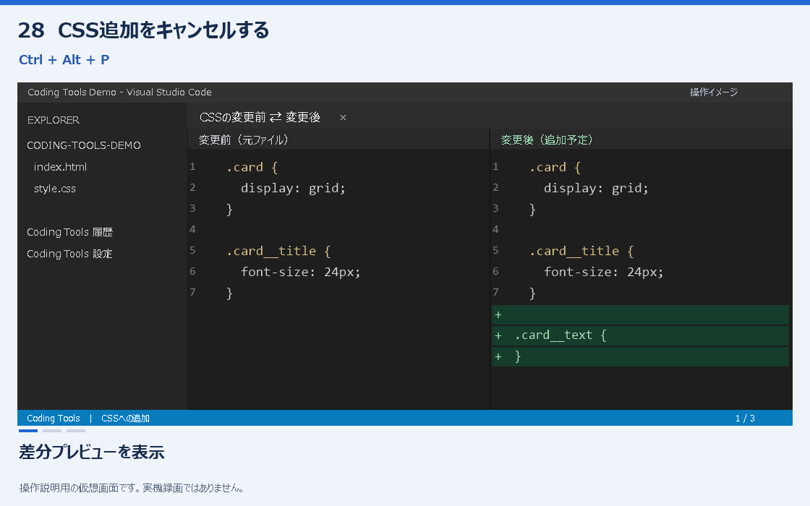

### 29 CSSを解析できなければ中止する

構文が壊れているなど、安全に追加できない場合は編集を中止します。

**Windows：** Ctrl + Alt + P

**Mac：** Cmd + Alt + P

1. 閉じかっこが足りないCSS。
2. Ctrl + Alt + P を実行。
3. 自動では変更されない。

### 30 追加したCSSを元に戻す

追加直後にVS Code標準のCtrl + Zで、その編集を取り消せます。

**Windows：** Ctrl  +  Z（VS Code標準）

**Mac：** Cmd  +  Z（VS Code標準）

1. 空の .card__text を追加した直後。
2. Ctrl + Z を押す。
3. 追加前の内容に戻る。

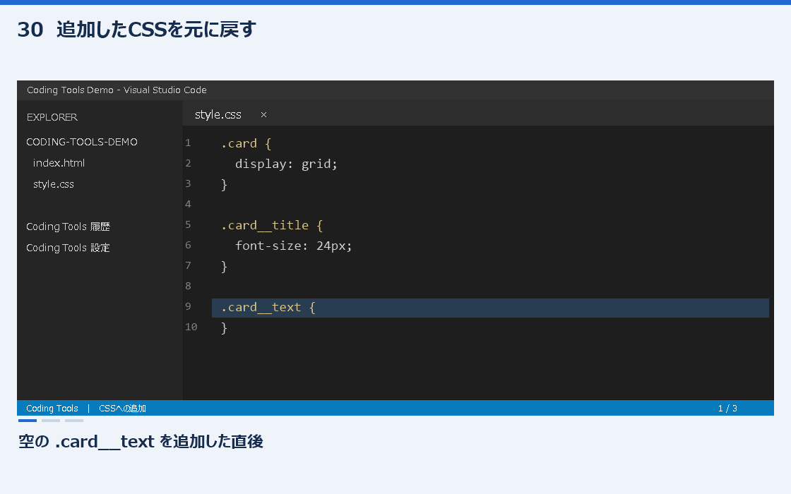

**補足：** 直前の編集を戻す操作です。間に別の編集をした場合は、その編集から戻ります。

## 履歴

### 31 履歴パネルを開く

エクスプローラー内の「Coding Tools 履歴」を開きます。

**Windows：** Ctrl + Alt + H

**Mac：** Cmd + Alt + H

1. エディタで作業している状態。
2. Ctrl + Alt + H を押す。
3. 履歴の種類と月を展開する。

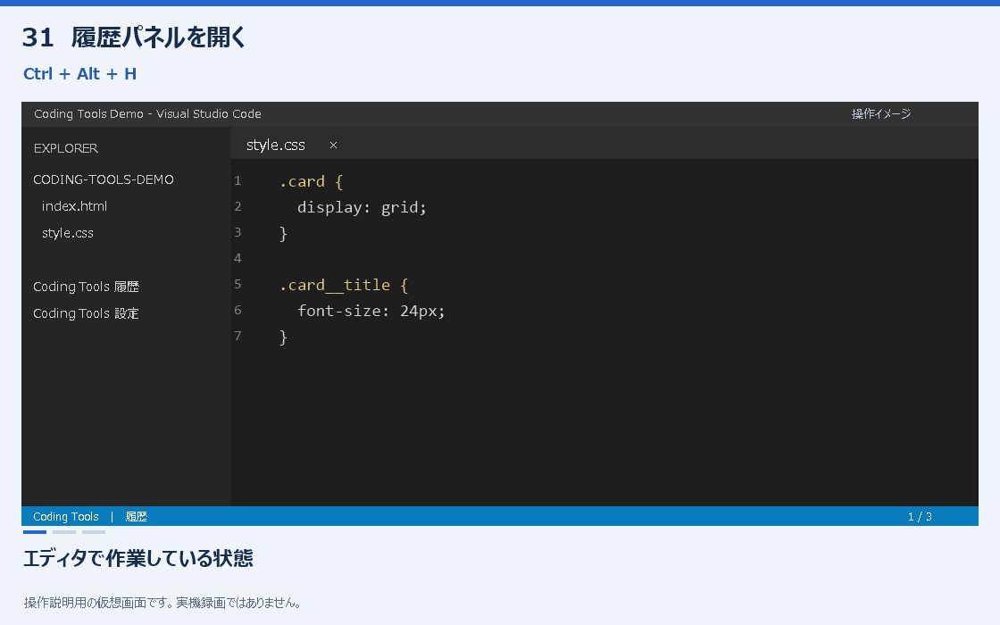

### 32 履歴を一覧から選ぶ

日時とファイル名の一覧から、見たい差分を選べます。

**開き方：** コマンドパレットで「Coding Tools: 差分履歴の一覧を開く」を実行します。

1. 「差分履歴の一覧を開く」を実行。
2. 見たい履歴を選択。
3. Enterで差分ファイルが開く。

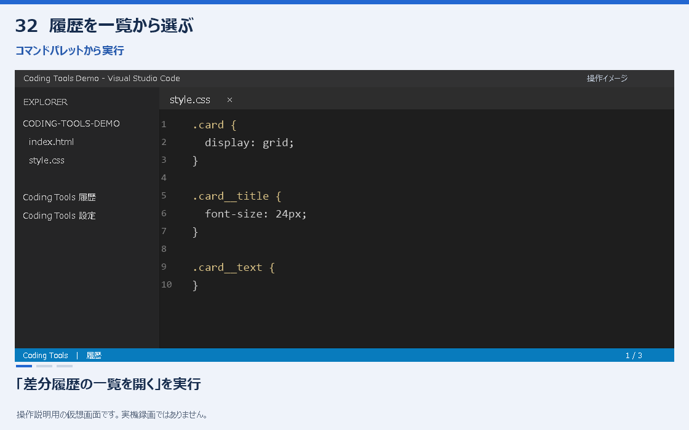

### 33 最新の差分を開く

一番新しく記録された差分を、一覧選択なしで開きます。

**開き方：** コマンドパレットで「Coding Tools: 最新の差分を開く」を実行します。

1. 「最新の差分を開く」を実行。
2. 最新の差分ファイルが開く。
3. 追加行は +、削除行は - で確認する。

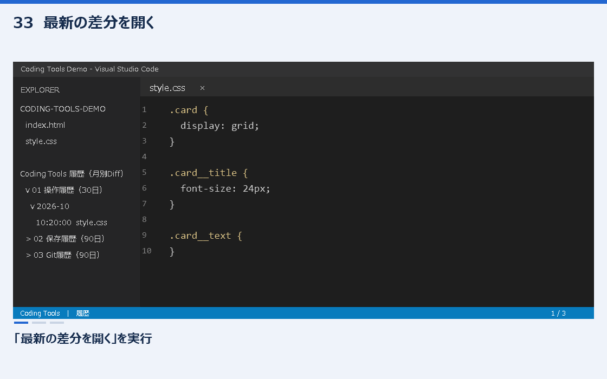

### 34 履歴の行をクリックして差分を見る

月の中にある履歴の行を選ぶと、その変更内容が開きます。

**Windows：** 履歴の行をクリック / Enter

1. 操作履歴と月を展開する。
2. 10:20:00 style.css をクリック。
3. 選んだ履歴の差分が開く。

### 35 履歴から変更元ファイルを開く

履歴の行から、編集した元ファイルの場所へ戻れます。

**Windows：** 履歴の行を右クリック → 変更元ファイルへ移動

1. 履歴の行を右クリックする。
2. 「差分の変更元ファイルへ移動」を選ぶ。
3. 元の style.css の変更箇所が開く。

**補足：** Git pushの履歴から実行した場合は、ソース管理画面を開きます。

### 36 履歴の表示を更新する

保存済みの履歴を読み直して、パネルの表示を更新します。

**開き方：** コマンドパレットで「Coding Tools: 差分履歴を更新」を実行します。

1. 履歴パネルを表示中。
2. パネル上の「差分履歴を更新」を実行。
3. 現在の保存内容で表示される。

### 37 履歴フォルダーを開く

保存された履歴のフォルダーを、OSのエクスプローラーで開きます。

**開き方：** コマンドパレットで「Coding Tools: 履歴フォルダーをOSで開く」を実行します。

1. 「履歴フォルダーをOSで開く」を実行。
2. 履歴保存先のフォルダーが開く。
3. 保存されている差分ファイルを確認できる。

### 38 ファイル保存時の差分を残す

保存履歴がONなら、前回保存した内容からの変更を保存時に記録します。

**Windows：** Ctrl  +  S（VS Code標準）

**Mac：** Cmd  +  S（VS Code標準）

1. 前回保存したCSS。
2. font-size を 24px から 28px に編集。
3. Ctrl + S でファイルを保存。
4. 保存履歴で差分を確認できる。

**補足：** 同じ内容を保存しただけの場合は記録しません。

### 39 Coding ToolsからGit pushして記録する

専用コマンドでpushが成功した場合に、Git push履歴を記録します。

**開き方：** コマンドパレットで「Coding Tools: Git pushを実行して履歴を記録」を実行します。

1. 実行前にブランチと送信先を準備。
2. 「Git pushを実行して履歴を記録」を実行。
3. 「実行」を選び、push成功を待つ。
4. Git履歴ONなら記録される。

**補足：** 通常のターミナルや、ほかの拡張機能から行ったpushは記録の対象外です。

## 設定

### 40 Coding Toolsの設定を開く

エクスプローラー内の「Coding Tools 設定」を表示します。

**開き方：** コマンドパレットで「Coding Tools: 履歴・最終確認の設定を開く（settings.jsonを変更しない）」を実行します。

1. 「履歴・最終確認の設定を開く」を実行。
2. エクスプローラーの設定欄へ移動。
3. 変更したい設定を選べる。

### 41 操作履歴の記録をON/OFF

設定欄の項目をクリックするか、選択してEnterを押すとON/OFFが切り替わります。

**Windows：** 設定欄の対象行をクリック / Enter

1. 操作履歴の記録は現在ON。
2. 対象の行で Enter を押す。
3. もう一度 Enter でONに戻す。

**補足：** OFFでも、すでに保存されている履歴はそのままです。

### 42 保存履歴の記録をON/OFF

設定欄の項目をクリックするか、選択してEnterを押すとON/OFFが切り替わります。

**Windows：** 設定欄の対象行をクリック / Enter

1. 保存履歴の記録は現在ON。
2. 対象の行で Enter を押す。
3. もう一度 Enter でONに戻す。

**補足：** OFFでも、すでに保存されている履歴はそのままです。

### 43 Git push履歴の記録をON/OFF

設定欄の項目をクリックするか、選択してEnterを押すとON/OFFが切り替わります。

**Windows：** 設定欄の対象行をクリック / Enter

1. Git push履歴の記録は現在ON。
2. 対象の行で Enter を押す。
3. もう一度 Enter でONに戻す。

**補足：** OFFでも、すでに保存されている履歴はそのままです。Git pushの実行自体もこの設定では止まりません。

### 44 CSS適用前の最終確認をON/OFF

設定欄の項目をクリックするか、選択してEnterを押すとON/OFFが切り替わります。

**Windows：** 設定欄の対象行をクリック / Enter

1. CSS適用前の最終確認は現在ON。
2. 対象の行で Enter を押す。
3. もう一度 Enter でONに戻す。

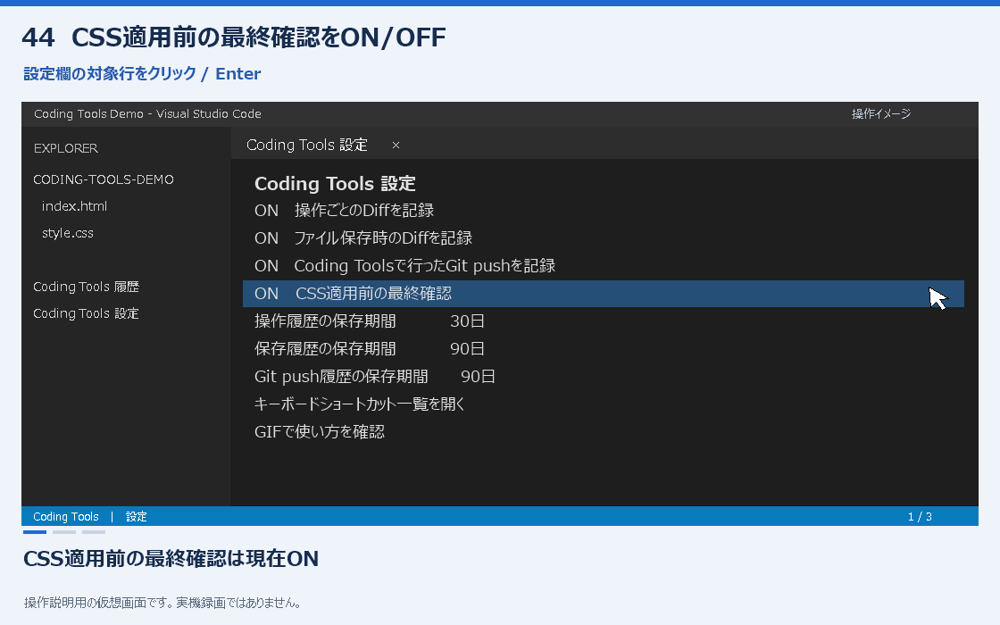

**補足：** OFFでも差分プレビューと配置候補の選択は残ります。最後の適用確認だけを省略します。

### 45 操作履歴の保存期間を変える

操作履歴について、履歴を残す日数を1〜360日で設定できます。

**Windows：** 設定欄の対象行をクリック / Enter

1. 操作履歴の保存期間の行を選ぶ。
2. 行を開いて日数を選ぶ。
3. 180日を選んで Enter。

**補足：** 任意の日数を入力する場合も、1〜360の整数を指定します。古い履歴は整理時に削除されます。

### 46 保存履歴の保存期間を変える

保存履歴について、履歴を残す日数を1〜360日で設定できます。

**Windows：** 設定欄の対象行をクリック / Enter

1. 保存履歴の保存期間の行を選ぶ。
2. 行を開いて日数を選ぶ。
3. 180日を選んで Enter。

**補足：** 任意の日数を入力する場合も、1〜360の整数を指定します。古い履歴は整理時に削除されます。

### 47 Git push履歴の保存期間を変える

Git push履歴について、履歴を残す日数を1〜360日で設定できます。

**Windows：** 設定欄の対象行をクリック / Enter

1. Git push履歴の保存期間の行を選ぶ。
2. 行を開いて日数を選ぶ。
3. 180日を選んで Enter。

**補足：** 任意の日数を入力する場合も、1〜360の整数を指定します。古い履歴は整理時に削除されます。

### 48 ショートカット一覧を開いて変える

VS Code標準のショートカット一覧で、Coding Toolsのキーを変更できます。

**開き方：** コマンドパレットで「Coding Tools: ショートカット一覧を開く」を実行します。

1. 設定欄のショートカット一覧を開く。
2. 検索欄に Coding Tools を入力。
3. 変えたい行のキー変更を開く。
4. 重複を確認してから使用する。

### 49 このGIFガイドを開く

Coding Toolsの設定欄から、1操作ずつのGIFガイドを開けます。

**開き方：** コマンドパレットで「Coding Tools: GIFで使い方ガイドを開く（1操作ずつ）」を実行します。

1. 設定欄の使い方ガイドを選ぶ。
2. VS Code内にガイドが開く。
3. 見たい操作の見出しを開く。

## CSSの設定

### 50 優先するCSSファイルを指定する

VS Codeの設定で、HTMLから追加するときに使うCSSファイルを指定できます。

**Windows：** VS Code 設定：codingTools.preferredStylesheet

1. Coding Toolsの優先CSS設定を開く。
2. ワークスペースの相対パスを入力。
3. 一致するCSSが1件なら、そのファイルを優先。

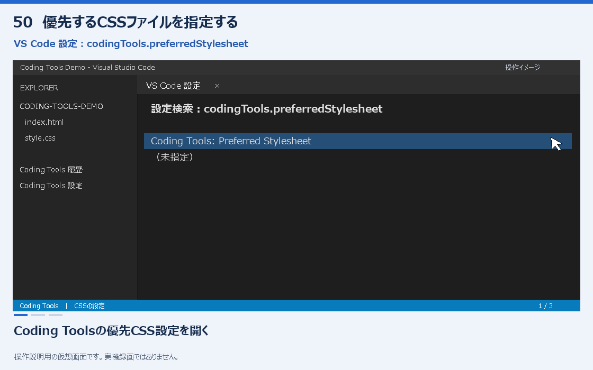

**補足：** このCSS配置設定はVS Codeのsettings.jsonで管理します。履歴のON/OFF設定とは保存先が異なります。

### 51 クラスの接頭辞ごとに追加先を指定する

クラス名の接頭辞に応じて、基本ルールか既存の@mediaを優先できます。

**Windows：** VS Code 設定：codingTools.placementRules

1. VS Codeのワークスペース設定を開く。
2. card__text をコピーしてCSS追加を実行。
3. 指定された条件内の差分を確認する。
4. 適用後、条件内に空ルールが増える。

**補足：** 値をbaseにすると基本ルールを優先します。該当する条件が一意に見つからない場合は、通常の追加先判断へ進みます。

## 困ったとき

- GIFが動かない：ブラウザ版を開き、「GIFを単独で開く」を選んでください。ブラウザやOSの「動きを減らす」が有効な場合、ガイド内では静止画になります。
- キーが反応しない：HTML/CSSのエディタにカーソルを戻し、キーボードショートカット一覧で割り当てと競合を確認してください。
- ジャンプできない：HTMLとCSSを含むフォルダーをVS Codeで開き、クラス名全体を選ぶか、そのクラス名にカーソルを置いてください。
- 貼り付け枠が空：先に同じ番号のコピー操作を実行してください。
- CSS追加が止まる：CSS構文と対応形式を確認してください。SCSS/LESSの自動配置は対象外です。
- 履歴が出ない：記録の設定をONにし、対象の編集・保存・Coding Tools経由のpushを行ってください。コピーだけでは差分履歴は増えません。
