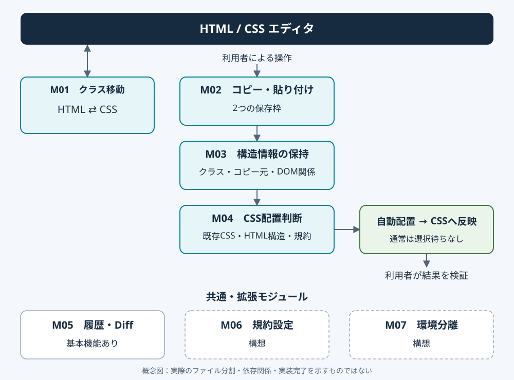

# VISION — Coding Tools

**HTMLとCSSのクラス操作をシームレスにつなぐVS Code拡張機能**

クラス名のコピー・貼り付け・移動・CSS配置を補助し、繰り返し操作と情報整理の負担を減らす。

その分、利用者がHTML/CSSの理解・設計・ブラウザでの検証に時間を使える環境を目指す。

[データと履歴の扱い](DATA_POLICY.md) ｜ [今後の実装予定](ROADMAP.md)

---

## 01. 全体構成

Coding Toolsを、役割ごとに独立したモジュールとして設計する。

### モジュール一覧

| ID | モジュール | 主な役割 | 現在の段階 |
| --- | --- | --- | --- |
| M01 | クラス移動 | HTML/CSS内のクラス間を移動 | 基本機能あり |
| M02 | コピー・貼り付け | 2つの保存枠で文字列を受け渡す | 基本機能あり |
| M03 | 構造情報の保持 | コピー元のクラス・周辺情報を保持 | 初期構築 |
| M04 | CSS配置判断 | HTML構造・既存CSSから追加先を判断 | 調整中 |
| M05 | 履歴・Diff | 操作と変更内容を記録・確認 | 基本機能あり |
| M06 | 規約プロファイル | 案件ごとのCSSルールを切り替える | 構想 |
| M07 | 利用環境の分離 | 個人版・企業版の機能を分ける | 構想 |

※ 基本機能が存在することと、すべての条件で動作検証済みであることは別。実装の詳細な進捗は [CURRENT.md](../CURRENT.md) で管理する。

### モジュールの関係

**基本操作**

M01 クラス移動 → HTML/CSS間を移動

**コピーからCSS配置まで**

M02 コピー・貼り付け → M03 構造情報の保持 → M04 CSS配置判断 → CSSへの反映 → 利用者による結果の検証

**共通の補助機能**

- M05：操作結果と変更履歴の記録
- M06：配置判断に利用する規約の設定
- M07：利用環境に応じた機能構成の切り替え

各モジュールの役割を分離し、一部の機能を変更しても他の機能に影響しにくい構成にする。

### 構成図

概念上のモジュール構成。実際のファイル分割や依存関係、実装完了を示す図ではない。

M01〜M07は、[SPEC.md](SPEC.md)・[CURRENT.md](../CURRENT.md)・[ROADMAP.md](ROADMAP.md)でも共通して使う。どの機能の仕様・進捗・不具合なのかを追いやすくする。

---

## 02. 基本操作モジュール

### M01 — クラス移動

移動するときの探索操作を減らす。

- HTML内のクラス名を順番に選択する。
- CSS内のクラスセレクタへ移動する。
- HTMLとCSSの対応箇所を探す。
- 標準のエディタ操作を妨げない。

### M02 — コピー・貼り付け

標準のクリップボードとは別に、2つの保存枠を用意する。

- コピーした文字列を保存する。
- 保存枠ごとに独立して保持する。
- 必要な位置へ貼り付ける。
- Ctrl+C / Ctrl+V の通常操作は変更しない。

操作を増やしすぎず、利用者が覚える手順を少なくする。クラス名へ編集カーソルを置くと、ファイル内・HTML⇄CSS移動の初期キーを簡易ヘルプで表示する。既定2秒で消え、表示OFFと表示時間を設定できる。

---

## 03. CSS配置モジュール

### M03 — 構造情報の保持

コピーしたクラス名だけでなく、CSS配置に必要な周辺情報を保持する。

**現行版で保持している情報**

- クラス名
- 取得可能な前後のクラス名
- コピー元情報（ファイル・言語・文書バージョン・クラスの位置）
- HTMLソースから取得した対象要素、親・祖先・子・前後の兄弟関係
- HTMLのセクショニング（section・article・nav・aside）と、main・header・footerなどの構造上の領域
- コピー元の構造と配置判断用の役割（セクション自身・見出し・子を持つ要素など、兄弟内の位置）
- 対象クラスのHTML全体での出現数・所属領域と、section/header/footerの並び

構造情報はコピー時点のスナップショットとして保存枠ごとに保持する。通常のクリップボードへ渡すのは文字列のみ。

取得対象はHTMLソース上で分かる構造。ブラウザ実行後のDOM、テンプレート展開結果、Flex/Gridなどの表示上の配置は推測しない。不完全なHTMLやテンプレートでは取得状況を「部分的」または「取得不可」として保持する。子要素の詳細は先頭32件まで保持し、総数と省略の有無も残す。

情報の取得・保持と、CSS配置の判断処理を分離する。保持する項目をコピー時の設定で選び、M04ではそのうち有効にした判断材料だけを利用する。設定と登録例は [WORKFLOW_SETTINGS.md](WORKFLOW_SETTINGS.md) に記載する。

### M04 — CSS配置判断

M03で保持した情報と、既存のCSS構造をもとに追加先を判断する。現行版は前後クラス・直接の兄弟・親のクラス、命名によるまとまりと登録セクションコメントによる範囲を利用する。対象クラスのHTML全体での共用と領域順も保持し、判断に使える。普段使うCSSコメントを登録し、sectionやheader/footerなどの空ルール追加時に付けられる。メディアクエリは利用者自身が記述する。通常は選択待ちを挟まず、コメントのまとまりへ追加する。対応する目印がなければ登録書式で作り、領域不明・共用の場合は仮置き用の目印を使う。手動で毎回選ぶ方式は設定で切り替えられる。

主な判断材料：

1. HTMLのセクショニングとCSSコメントの対応
2. クラスの親子・兄弟関係
3. セレクタの構造と詳細度
4. 既存ルールの配置順序
5. メディアクエリなどの適用範囲
6. 案件固有の規約（将来のM06）

**判断の原則**

- 既存コードを優先して確認する。
- 同じルールの重複作成を避ける。
- 配置の根拠を利用者に示す。
- 曖昧な配置は仮置きと分かる目印を付け、利用者が結果を確認できるようにする。
- 既存コードへ無断で破壊的変更をしない。
- Undoなどによって変更を戻せるようにする。

CSS配置の自動判断は現在調整中。ここに記載したすべての条件への対応を保証するものではない。

---

## 04. 履歴・データ管理モジュール

### M05 — 履歴・Diff

利用者自身が操作結果を振り返り、誤判定を再現・改善するための機能。

**目的**

- コード変更の追跡
- 誤操作・誤判定の原因確認
- 操作時間や効率の検証
- 個人環境の改善

**データの扱い**

作者は利用者のコード・コピー内容・操作履歴を収集しない。

現行版の履歴は利用者のローカル環境に保存する。必要な記録だけを本人が選び、GPTなどによる分析へ利用できる運用を想定する。

GPTへの自動送信・自動レポート生成は未実装。

詳細は [DATA_POLICY.md](DATA_POLICY.md) に記載する。

---

## 05. 将来の拡張モジュール

### M06 — 規約プロファイル

職場・案件によって異なるコーディング方針を、共通エンジンから分離して管理する。

**設定対象**

- クラス命名規約
- CSSの整理順序
- HTMLのセクショニング方針
- 親子・兄弟セレクタの扱い
- メディアクエリの配置方法
- レイアウトに関する方針

利用者が設定画面から規約を確認・変更し、案件ごとに切り替えられることを目指す。

### M07 — 利用環境の分離

共通の機能基盤を維持しながら、利用目的に応じて機能構成を分ける。

| 構成 | 方向性 |
| --- | --- |
| 個人版 | 本人が履歴を記録・分析・改善に利用する |
| 企業版 | 履歴記録機能を含めず、業務用途に必要な機能を提供する |
| 共通基盤 | クラス操作・CSS配置などの中核機能を共有する |

履歴の有無と、規約プロファイルの内容は別々に管理する。

M06・M07はいずれも構想段階。

---

## 06. 開発と評価の原則

1. **単純な操作** — 導入時に覚える操作・設定を最小限にする。
2. **標準機能との共存** — VS Codeの通常操作を妨げない。
3. **判断の可視化** — 自動処理の根拠と例外を確認できるようにする。
4. **安全な変更** — 曖昧な判断で既存コードを破壊しない。
5. **モジュールの独立性** — 不安定な機能を無効化・分離・削除できる構造にする。
6. **データの分離** — 個人データ・職場データ・機能の設定を混在させない。
7. **実測による評価** — 操作時間・誤操作・Undo・保守負担で実用性を判断する。
8. **実装状況の区別** — 実装済み・検証済み・調整中・構想を混同しない。

---

## 07. 到達目標

**繰り返し操作はツールが補助し、理解・設計・検証は利用者が行う。**

最初は個人のHTML/CSS学習と制作を効率化する。

その後、基本機能の安定性と実用性を検証し、必要に応じて規約プロファイルや利用環境の分離へ拡張する。

共通エンジンを維持しながら、個人利用から実務・チーム利用まで対応できる構造を目指す。
